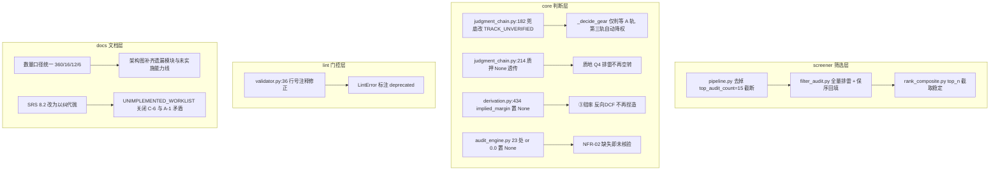

## 产品概述

对 AST-Trader 审计报告核实结论实施工程闭环：修正被证实的 4 项代码级缺陷与 2 项漏检高危点，落地 3 项用户裁决决策，消除全部文档漂移并补齐架构描述遗漏项，最终以全量回归 + 前后差异对比验证不引入回归。

## 核心功能

1. **修复 Tier 2 漏斗截断**：取消 `screener/pipeline.py:57` 的 `top_audit_count=15` 截断，使 Tier 1 全部合格候选进入排雷；同时修复 `filter_audit.py` 因 `as_completed` 导致的线程完成序乱序，保证进入 Tier 3 的顺序与 Tier 1 输出序一致，`rank_composite` 的 top_n 截取稳定可复现。
2. **物种分流新增未核验第三轨**：`judgment_chain.py:182` 兜底不再返回"机构趋势与产业中军"，改为 `TRACK_UNVERIFIED` / "未核验(物种未定)"，下游按未核验降权处理（不享受中军档位与仓位上限），修正永安行等缩量小票被冠以"产业中军"的商业常识违和。
3. **修正两处数据纪律高危点**：`derivation.py:434` 反向 DCF 的 `implied_margin` 由硬编码 16.5% 改为缺失即 `None`/未核验；`judgment_chain.py:214` 质押率不再 `or 0.0` 兜底，与采集层 None 纪律对齐。
4. **C-5 分两步清理 0 兜底**：先为 Piotroski / Dupont / Buffett / InvestIncomeErosion 各补一组"全字段缺失"基线断言锁定当前行为，再逐模块改造 22 行 23 处 `or 0.0`，改造后逐项对比差异并记录。
5. **C-6 门控哲学裁决落地**：以代码为准反向修订 `ARCHITECTURE_AND_SRS.md` §8.2 为"以纠代抛：降级为等证据临界(观察) + position_cap=0.0"，`LintError` 标注 deprecated 保留兼容语义，关闭待裁决问题。
6. **文档一致性收口**：统一测试数量（360 = 349 离线 + 11 seednet）、门控规则数（16 条）、审计模型数（12 个）、装配方法数（6 个），补齐架构图遗漏模块与未实施能力线标注，消除 `UNIMPLEMENTED_WORKLIST` 内部 A-1 接线 2/5 与 5/5 的矛盾。

## 边界与非目标

- 保持 `config.AI_ENABLED=False` 默认关闭不变；不改动 `docs/SEED_VALIDATION_REPORT.md` 历史跑批快照数字。
- DIFF-06 经核实为文档归因错误，`docs/ARCHITECTURE.md` 未描述过节点来源，不做修改。
- 不新增第三方依赖；`lint/` 维持纯叶子层，不得反向 import `core/`。

## 技术栈

沿用项目现有栈，不引入新依赖：Python 3 + pandas + eltdx（通达信协议）+ jsonschema（Draft202012Validator）+ rich + pytest（含 `seednet` 标记分组）。测试沿用 `pytest.ini` 与 `tests/conftest.py` 已有的缓存隔离/产物目录隔离夹具。

## 实现方案

### 总体策略

按"代码修复 → 测试围栏 → 语义改造 → 文档收口 → 全量回归"的顺序推进。代码修复项彼此无耦合可并行；C-5 严格串行（先围栏后改造），因为其本质是把"缺失填 0"改为"缺失置 None"的**语义变更**，会让未核验路径首次真正生效，必须先锁定基线才能对比差异。

### 关键技术决策

**决策 1：Tier 2 去截断 + 顺序稳定（必须同时做）**
仅删 `top_audit_count` 不够。`filter_audit.py:88-93` 用 `as_completed` 收集，输出顺序是线程完成序，取消截断后候选变多，乱序会让 `rank_composite(top_n=...)` 截取结果不可复现。方案：

- `filter_audit(candidates, collector, max_workers=5, top_audit_count=None)` —— `None` 表示不截断（默认全量），保留 int 入参以兼容既有测试与调用方。
- 并发执行改为"先 `executor.submit` 建立 `future -> 原始索引` 映射，再按输入序回填结果"，即并发提速但输出保序。
- 顺序稳定性作为显式契约写入回归测试（传入打乱顺序的候选，断言输出顺序严格等于输入顺序）。
- 性能：`max_workers=5` 不变，候选由 15 增至典型 30~60，单次排雷 IO 不变，总耗时线性增加但仍远低于 SRS 的"全市场漏斗 ≤15 秒"验收线；若实测超线，退路是提高 `max_workers` 而非恢复截断。

**决策 2：第三轨 `TRACK_UNVERIFIED` 的最小侵入实现**
全仓 `stock_track` 消费点仅 5 处（`:921` 赋值、`:605`/`:1044` 传参、`:652` 判等 A 轨、`:1107` 写卡）。`:652` 的判据是 `stock_track == "TRACK_A_THEME"`，第三轨自动落入后续分支，**无需改动判断逻辑**即可实现"不享受 A 轨弱市防守语义"；同时需在 `_build_pillar_1_quality`/Q4 与卡面展示层显式标注"物种未核验"。已验证 `decision_card.schema.json` 无 `stock_track` 枚举约束，新增取值不会触发 R1 契约失败。

**决策 3：数据纪律两处高危点的差异化处理**

- `derivation.py:434` `implied_margin` 是**凭空赋值**（非兜底），下游无消费方且 schema 无约束 → 直接改为 `None` 并附 `"未核验"` 语义，同时把 `15.0 / (1/5) / 25.0 / 1.2 / 35.0 / 20.0` 等魔数收敛为具名常量或 config 项。
- `judgment_chain.py:214` 改为 `pledge_ratio = (governance_info or {}).get("pledge_ratio")` 保持 None 透传，并新增 `pledge_verified = pledge_ratio is not None` 单一真值判据（与 `filter_audit.py:46-47` 口径一致），避免"两个可漂移的真值来源"。

**决策 4：C-5 测试围栏的设计**
围栏必须断言**当前（改造前）行为**，即"全字段缺失时模型输出什么"，采用具体固定断言（红标题/级别/阈值字符串），杜绝 `if...else...` 伪用例（遵循 `FUTURE_OPTIMIZATION_SPECIFICATIONS.md:287`）。围栏覆盖 4 个函数：Piotroski(3 处)、Dupont(8 处)、Buffett(10 处)、InvestIncomeErosion(2 处)。Beneish / Altman / Sloan 实测无 `or 0.0`，**不纳入改造范围**（避免扩大爆炸半径）。改造后重跑围栏，逐项 diff 记录"哪些红旗从有到无 / 从无到有"。

### 性能与可靠性

- 热路径：Tier 2 排雷是网络 IO 密集（每只票 1 次 F10 调用），去截断后调用数从 ≤15 增至实际候选数，采用保序并发而非串行，避免放大耗时；上游 `LadderAnalyzer` 与 Tier 1 不变。
- 日志：复用 `logging.getLogger("ast_trader.screener.audit")`，仅在截断被显式指定时记 warning；不打印候选全量 payload。
- 爆炸半径控制：`top_audit_count` 保留为可选参数（默认 None=全量），既有 `tests/test_phase1_fixes.py:73` 以默认参数调用，行为从"截 15"变为"全量"，需确认其候选数 ≤15 或同步更新断言。

## 实现备注（防回归要点）

1. `search_content` 工具对 `core/audit_engine.py`、`core/youzi_personas.py` 存在返回 0 命中的不稳定情况，精确计数/定位一律用 `python -c` 脚本复核。
2. `lint/validator.py:36` 的过期行号注释「judgment_chain.py:743-752」必须同步改为 762-777（实际降级逻辑位置），否则后续审计会再次复读错误行号。
3. 新增/修改测试不得使用 `if...else...` 形式的伪断言；离线测试须无网可执行（不挂 `seednet` 标记）。
4. 每批改造后必须跑 `python -m pytest -m "not seednet" -q` 确认 349+ 全绿，再进入下一批。

## 架构设计

改动均落在既有分层内，不引入新架构模式：



## 目录结构

```
d:/workspace/ast-trader/
├── screener/
│   ├── pipeline.py                 # [MODIFY] 删除 :57 的 top_audit_count=15 传参，改为全量排雷；日志文案同步（"初筛前 15 只" → "全部合格候选"）
│   └── filter_audit.py             # [MODIFY] :18 签名 top_audit_count 默认改 None(不截断)；:35 条件截断；:88-93 as_completed 改为按输入索引保序回填；:95-99 日志输出实际检查数
├── core/
│   ├── judgment_chain.py           # [MODIFY] :157-182 classify_stock_track 兜底返回 TRACK_UNVERIFIED/"未核验(物种未定)"；:214 质押率 None 透传 + pledge_verified 单一真值
│   ├── derivation.py               # [MODIFY] :427-438 反向 DCF：implied_margin 改 None，魔数 15.0/5.0/25.0/1.2/35.0/20.0 收敛为具名常量
│   └── audit_engine.py             # [MODIFY] 第二批：Piotroski(182/199/210)、Dupont(490-498)、Buffett(549-600)、InvestIncomeErosion(671) 共 22 行 23 处 or 0.0 改为 None 语义 + 上游 is None 判据
├── lint/
│   └── validator.py                # [MODIFY] :36 过期行号注释 743-752 → 762-777；:88 LintError 补 deprecated 说明（保留类定义不删，供兼容语义）
├── tests/
│   ├── test_screener.py            # [MODIFY] 新增 Tier2 全量排雷 + 输出保序回归用例
│   ├── test_judgment_enhancement.py# [MODIFY] 新增 TRACK_UNVERIFIED 三分支 + 质押 None 透传用例
│   ├── test_derivation_discipline.py# [NEW] 反向 DCF 缺失即未核验（implied_margin is None）断言
│   └── test_audit_missing_fields.py# [NEW] C-5 测试围栏：Piotroski/Dupont/Buffett/InvestIncomeErosion 全字段缺失基线断言
├── README.md                       # [MODIFY] :120/:143/:146/:150 测试数量 166/155 → 360/349
├── ARCHITECTURE_AND_SRS.md         # [MODIFY] :32 FR-05 12 条 → 16 条；:120 验收标准"抛异常" → "以纠代抛降级清零"（C-6 裁决）
├── docs/
│   ├── ARCHITECTURE.md             # [MODIFY] :171 测试数 166 → 360(349+11)；:172 规则数 7 条 → 16 条并删除"R1~R6 无定义"旧结论；架构图补齐 trap_detector/seat_matcher/execution_playbook/red_flags/types/capital_matrix/investor_panel/game_features/ai_enrichment 与未实施能力线标注
│   ├── ROADMAP_AND_AI_EVOLUTION.md # [MODIFY] :76 测试数 56 → 360
│   ├── FUTURE_OPTIMIZATION_SPECIFICATIONS.md # [MODIFY] :5 基线 74 项 → 360；注明 A-1 已接线且默认关闭
│   └── UNIMPLEMENTED_WORKLIST.md   # [MODIFY] :103 C-5 精确化为 22 行 23 处分布；:104 C-6 标记 ✅ 已裁决；:160 移除待裁决问题 1；:172 A-1 接线 2/5 → 5/5 对齐 :74
└── reports/                        # [NEW] 可选：输出改造前后红旗差异对比摘要
```

## 关键代码结构

```python
# screener/filter_audit.py —— 去截断 + 保序契约
def filter_audit(
    candidates: list[dict[str, Any]],
    collector: EltdxCollector,
    max_workers: int = 5,
    top_audit_count: int | None = None,   # None = 全量排雷（不再默认截断 15）
) -> list[dict[str, Any]]: ...

# core/judgment_chain.py —— 物种分流三轨契约（schema 无枚举约束，可安全扩展）
TRACK_A_THEME = "TRACK_A_THEME"                 # 短线题材与接力博弈
TRACK_B_INSTITUTIONAL = "TRACK_B_INSTITUTIONAL" # 机构趋势与产业中军（需真实市值门槛命中）
TRACK_UNVERIFIED = "TRACK_UNVERIFIED"           # 未核验(物种未定)：兜底取值，下游按未核验降权
```

## Agent Extensions

### SubAgent

- **code-explorer**
- Purpose：在第二批改造前，用 medium~very thorough 粒度复核 `stock_track` / `classify_stock_track` / `filter_audit` / `reverse_dcf` / `pledge_ratio` 的全仓调用点与测试断言点，确认无遗漏消费方
- Expected outcome：输出完整的调用点与断言点清单，确保第三轨取值与 None 语义改造不遗漏任何下游分支

### Skill

- **lsp-code-analysis**
- Purpose：对 `classify_stock_track` 与 `_decide_gear(stock_track=...)` 做 find references / call hierarchy 影响面分析，验证第三轨改动的实际影响范围
- Expected outcome：给出符号级引用列表，与 grep 结果交叉验证，确认 `:652` 是唯一需要关注的判等点