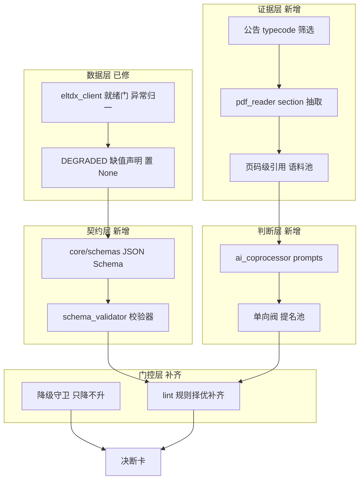

## 产品概述

以 GitHub 上游 Ashare-researchreport 的方法论与架构为基准（代码不回退），在**保留 ast-trader 短线快筛定位与既有优势**的前提下，补齐四层缺失能力。核心约束：**借鉴而非照抄**——逐项判定上游设计的适用性，不适配短线/快筛/eltdx 数据源的一律改造或拒绝。

## 核心功能

1. **数据层修复**：补 `eltdx_client` 缺失的就绪门与异常归一能力；建立缺值语义集中声明，一律置 `None`（严守项目 NFR-02 血律，不填 0）。
2. **契约层**：为决断卡五支柱与 AI 输出建立 JSON Schema 强契约 + 校验器，使 AI 结论可被机检。
3. **门控层**：按上游规则精神补齐门控，优先补「数字唯一出处」「红旗闭环」「推导闭合」「证伪同源」等高价值规则；不适用项改造，无阻断力项拒绝。
4. **证据层**：移植改造 PDF 精读，抽取公告正文并带**页码级引用**，为文本深扒提供语料。
5. **判断层**：新增 AI 协处理器，替换 5 处硬编码（护城河、催化临界点、题材纯度、治理文本、情景战术）；AI **只能降级判定、只能提名风险**，绝不产出数值。

## 明确拒绝项

- 拒绝上游「缺失填 0」做法（与 NFR-02 冲突）。
- 拒绝移植上游 Tushare 取数层（与 eltdx 数据源冲突）。
- 拒绝移植上游章预算、外链引用等长文形态规则。
- 拒绝移植上游自认无阻断力的散文密度规则。
- 不弱化 ast-trader 自有优势：行业适用性弃权、24 游资画像、连板天梯、执行手册、全市场快筛。

## 技术栈

- 语言与运行时：Python 3.11+（沿用 ast-trader 现状）
- 契约校验：`jsonschema`（Draft 2020-12）+ `referencing`（实现跨文件 `$ref`）
- PDF 解析：`pypdf`（上游同款，零内部依赖）
- AI 接入：OpenAI 兼容 HTTP 客户端（`urllib` 或 `requests`，不引入重型 SDK）
- 测试：pytest（现有 166 项不得回归）
- 数据源：eltdx（沿用，不引入 Tushare）

## 总体思路

**「脚本算、AI 写、跨节点只引不推」**——沿用上游最核心的职责分离原则，但把「子代理编排」改造为「函数调用」。数值永远由量化中台锁定，AI 仅输出定性结论与证据引用。

三条硬边界（贯穿全部实现）：

1. **AI 只能降级**：判定只允许从优向劣迁移，禁止反向升级。
2. **AI 只能加风险**：通过写手提名池单向注入红旗，无「加信心」通道。
3. **AI 失败即弃权**：超时/校验失败/无证据一律返回 `None` 并回退现有规则，严禁输出伪装结论。

## 适用性三分类（本方案核心）

### A. 借鉴（架构精神）

| 上游设计 | 借鉴要点 |
| --- | --- |
| 脚本算 / LLM 写 / 只引不推 | 职责分离，AI 无权限产出数值 |
| `red_flag_nominations` 单向阀 | LLM 只加风险，且可机检 |
| 15 份 JSON Schema + jsonschema | AI 输出必须先有契约 |
| `[PDF:xxx, P.N]` 引用 + 门控 | 证据绑定，无引用即弃权 |
| `DEGRADED` 集中声明缺值 | 但按 NFR-02 置 `None` 而非 0 |
| `flag_id` 数值脱敏 | 保证刷新后 id 稳定 |
| 显式依赖图 + 波次 | 把五支柱依赖显式化 |
| triage 零 LLM | diff 机检驱动增量复查 |


### B. 改造（形态差异）

| 上游形态 | 改造为 |
| --- | --- |
| 10 个 LLM 子代理，Claude Code/Codex 编排 | 无 agent 宿主 → `prompts/*.md` + 函数调用 |
| 分钟级单股深度研报 | AI 仅进 `analyze`；`screen` 全市场 ≤15s 绝不调 AI |
| Tushare 取数 | 沿用 eltdx；上游依赖 Tushare 独有接口的规则标注「数据源待接入」 |
| 章预算（70/60/70/60/50 行） | 改为「决断卡字段预算 / 面板瓦片数」 |
| `check_phase2` 的 md 八节结构 | 只取「证据引用门控」精神，不移植 md 结构 |
| R9 字面短语表（可绕过） | 升级为 AI 语义判据 |


### C. 拒绝

- 缺失填 0（违反 NFR-02）
- 上游 Tushare 取数层
- 散文密度规则（上游源码自认无阻断力）
- 上游无游资/连板/短线 → 题材纯度与情景战术自研，不参照上游

## 架构设计



**依赖顺序**：数据层与契约层可并行 → 门控层依赖契约层 → 证据层依赖数据层 → 判断层依赖前三者。

## 实施要点

### 性能

- AI **绝不进入** `screen` 与 Tier1-3；仅 `analyze` 单股路径启用。
- 单股 5 个模块并发上限 3，单模块超时 8s，总预算 30s 硬熔断。
- 缓存键：`(module, 公告 rec_id 集合哈希, model, prompt_version)`；命中即跳过调用。
- PDF 按公告类型精准取（问询函回复、审计说明通常数页），长文检索式抽取而非全量投喂；**明确标注截断**（纠正上游 8000 字静默截断的缺陷）。
- 原有 166 项测试全部离线确定性，AI 关闭时零额外开销。

### 日志

- 复用项目现有 logger；记录模块名、耗时、token 用量、弃权原因。
- **禁止**记录 API Key、prompt 全文、PDF 原文段落。
- 弃权按 `warning` 采样记录，避免刷屏；错误需可定位到 `ticker + module`。

### 爆炸半径控制

- `AI_ENABLED` 默认 `False`，需显式开启；`.env` 入 `.gitignore`，Key 走 `os.getenv`。
- 新增 pytest marker `ai`，`pytest.ini` 默认不选，保证 166 项确定性。
- 门控规则采用「逐条独立开关」，新规则先以 warn 观察一轮再转 fail。
- 不改动现有 5 处硬编码的默认行为——AI 关闭时输出与现状逐字一致。

## 目录结构

```
d:/workspace/ast-trader/
├── config.py                          # [MODIFY] AI 端点/模型/超时/预算/降级方向常量
├── requirements.txt                   # [MODIFY] 新增 pypdf、jsonschema
├── data/
│   ├── eltdx_client.py                # [MODIFY] 补 require_extension/extension_ready/异常归一/代码归一
│   ├── degraded.py                    # [NEW] 缺值语义集中声明，统一置 None 与降级说明
│   ├── pdf_reader.py                  # [NEW] 移植改造：section 抽取 + 物理页码 + 显式截断标注
│   └── announcement_corpus.py         # [NEW] 公告按类型码筛选 + PDF 下载 + 语料池
├── core/
│   ├── schemas/                       # [NEW]
│   │   ├── common.schema.json         # 子判定、证据引用、红旗提名等公共定义
│   │   ├── decision_card.schema.json  # 决断卡五支柱契约
│   │   └── ai_enrichment.schema.json  # AI 输出契约（强约束枚举与必填）
│   ├── schema_validator.py            # [NEW] Draft202012 校验 + 跨文件 $ref 注册
│   ├── ai_enrichment.py               # [NEW] AIEnrichment / EvidenceRef / RedFlagNomination 定义
│   ├── ai_coprocessor/                # [NEW]
│   │   ├── provider.py                # OpenAI 兼容客户端：超时/重试/熔断
│   │   ├── cache.py                   # 按内容哈希持久缓存
│   │   ├── guard.py                   # 降级守卫 + 证据校验 + fail-closed
│   │   └── prompts/                   # moat / catalyst / theme_purity / governance / tactic
│   ├── red_flags.py                   # [MODIFY] 接入提名池，flag_id 数值脱敏
│   ├── judgment_chain.py              # [MODIFY] 五问接 AI 增强，经守卫后并入
│   ├── audit_engine.py                # [MODIFY] 治理文本穿透，接公告语料
│   ├── youzi_personas.py              # [MODIFY] 题材纯度去伪存真
│   └── execution_playbook.py          # [MODIFY] 情景战术描述（价格点位仍由量化锁定）
├── lint/
│   ├── validator.py                   # [MODIFY] 规则择优补齐 + 逐条开关
│   └── rules_number_home.py           # [NEW] 数字唯一出处规则
├── presentation/html_renderer.py      # [MODIFY] 渲染证据引用与提名来源
├── docs/UNIMPLEMENTED_WORKLIST.md     # [MODIFY] 更新 A-1 状态与新增条目
└── tests/
    ├── test_contract_schemas.py       # [NEW] 契约层：合法/非法样本校验
    ├── test_ai_guard.py               # [NEW] 降级守卫：AI 不得升级判定
    └── test_pdf_evidence.py           # [NEW] 证据层：页码引用与截断标注
```

## 关键代码结构

```python
@dataclass(frozen=True)
class EvidenceRef:
    """证据引用。AI 结论必须绑定可核验证据，无引用即弃权。"""
    source: str            # announcement | metrics | news
    url: str               # 公告 PDF 原始链接
    page: int | None       # 物理页码
    quote: str             # 原文片段，禁止转述


@dataclass(frozen=True)
class AIEnrichment:
    """AI 语义增强结果。任一环节失败即返回 None（fail-closed）。"""
    module: str                              # moat|catalyst|theme_purity|governance|tactic
    judgment: str | None = None              # 仅允许降级，由 guard 强制
    evidence: tuple[EvidenceRef, ...] = ()   # 非空才生效
    nominations: tuple[RedFlagNomination, ...] = ()   # 单向阀：只能加风险
    abstained: bool = False
    reason: str = ""                         # 弃权原因：超时/无证据/校验失败
```

```python
def apply_enrichment(
    rule_judgment: str,            # 现有量化/规则判定，唯一可信基线
    ai: AIEnrichment | None,
) -> str:
    """降级守卫：AI 只能把判定向劣迁移，禁止反向升级。

    允许：优→中、中→差、优→差
    禁止：差→中、中→优、差→优
    AI 为 None / abstained / 证据为空时，原样返回规则判定。
    """
```

```python
def validate(payload: dict, schema_name: str) -> list[str]:
    """校验并返回错误列表，空列表表示合法。

    采用 Draft202012Validator + referencing.Registry 注册
    core/schemas 下全部 schema，支持跨文件 $ref。
    """
```

## Agent Extensions

### Skill

- **pdf**
- 用途：证据层落地时处理公告 PDF 的解析、文本与表格抽取、加密与中文编码兜底
- 预期结果：确定 `pypdf` 之外的兜底方案，解决上游静默失败与无表格抽取的缺陷
- **eltdx-f10-finance-news**
- 用途：确认 `f10.announcements` 的类型码枚举与 PDF 链接构成规则，锁定问询函/审计说明/减持公告的筛选条件
- 预期结果：产出可直接编码的公告类型筛选清单，避免「取不到」被误判为「不存在」
- **eltdx-api-index**
- 用途：为「治理文本穿透」与「题材纯度」反查 eltdx 可用接口与调用路径
- 预期结果：明确每个所需字段的接口归属，缺失项标注为数据源待接入而非伪造

### SubAgent

- **code-explorer**
- 用途：门控层实施前，精确比对上游 `lint_v8.py` 各规则判据与 ast-trader 现有实现的差异
- 预期结果：产出逐规则的「可借鉴判据 / 需改造点」清单，避免照抄不适用规则