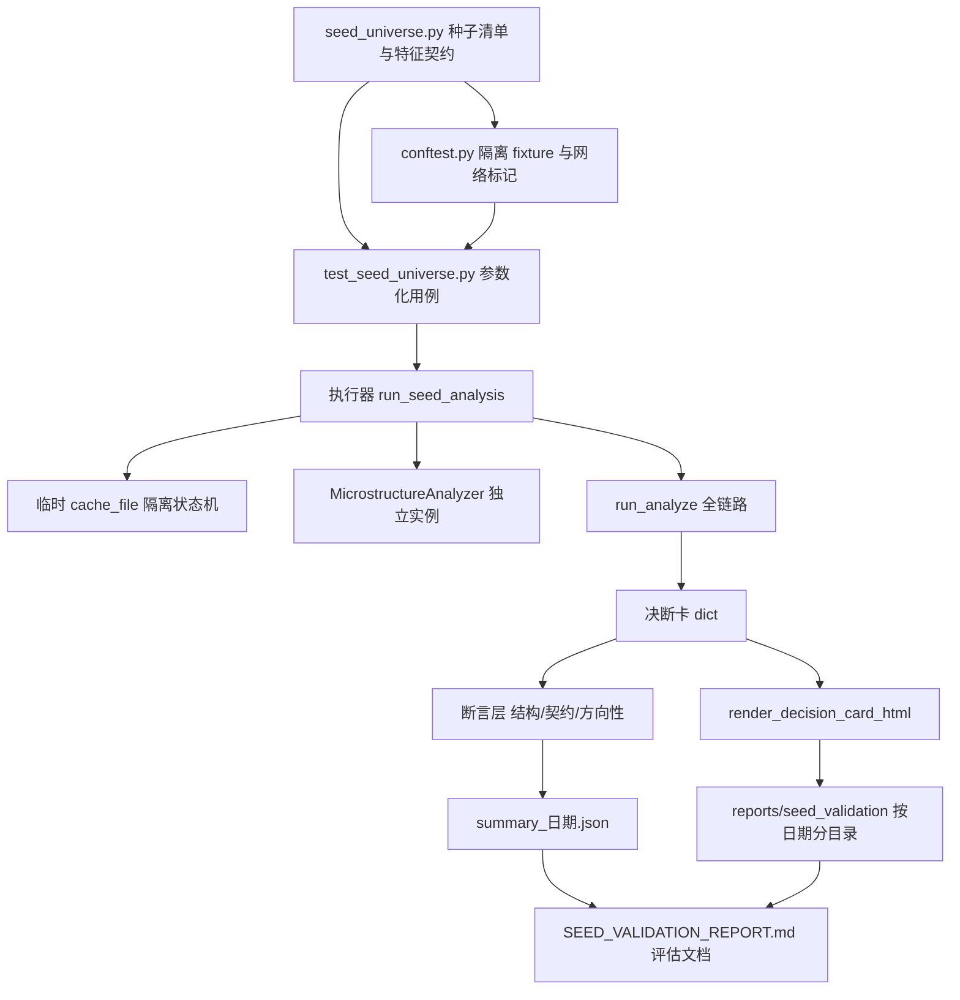

## 产品概述

为 AST-Trader 构建一套面向 A 股真实市场结构的种子标的验证集：选取覆盖不同行业、市值规模与财务特征的典型个股，驱动完整的个股分析链路产出具结断卡，再系统性评估系统结论与实际特征的吻合度、筛选逻辑对 A 股市场的适配性，并输出可执行改进建议。

## 核心功能

1. **种子清单与特征契约**：定义 8-10 只分层种子标的，每只附带预期特征注解（所属板块、市值档位、行业属性、财务特征、风险标签），作为后续吻合度比对的基准。
2. **全链路跑批执行**：逐只驱动行情、财务三表、审计排雷、微观结构、龙虎榜、杀猪盘雷达、游资战法到五支柱决断链的完整分析流程，生成终端决断卡与离线 HTML 研报。
3. **三层断言守护**：结构完整性不变量、风控契约不变量、方向性特征断言，以常驻回归测试形式防止行为退化。
4. **结构化摘要采集**：输出机器可读的摘要数据（板块、档位、仓位、三支柱判定、红旗清单、接口健康度、门控发现），作为评估阶段的证据基础。
5. **筛选逻辑静态评估**：基于既有实跑产物与漏斗源码走查，评估三层漏斗对 A 股行业分布、市值结构、财务指标口径与常见风险因素的适配性。
6. **评估报告产出**：汇总数据偏差、逻辑漏洞与不适配假设，按严重度给出具体改进建议。

## 边界与约束

- 仅执行个股分析链路，不运行依赖当日涨停天梯的全市场筛选。
- 数据采用实时联网直取，不落 fixture 快照；因此断言限定为不变量与方向性断言，严禁对价格、评分等日变数值做精确断言。
- 种子特征会随时间漂移（如摘帽、质押率变化），运行时校验不通过者标记为跳过而非失败。
- 交付形态为常驻回归测试集，落在 `tests/` 下可重复运行。

## 技术栈

沿用项目现有技术栈，不引入新框架：

- 语言与运行时：Python 3.13（现有环境）
- 测试框架：pytest（`pytest.ini` 已配置 `pythonpath = .`、`testpaths = tests`）
- 数据底座：`eltdx 3.3.0`（已安装并声明于 `requirements.txt`）
- 复用模块：`cli.run_analyze`、`core.judgment_chain.JudgmentChainRunner`、`core.main_force_engine.MainForceStateEngine`、`presentation.html_renderer.render_decision_card_html`

## 实现方案

### 总体策略

将"种子验证"设计为**数据驱动的参数化回归套件**：种子清单与预期特征以声明式结构体集中定义，执行器负责隔离副作用地跑批并采集摘要，断言层按不变量分级。评估阶段不写在测试里，而是基于摘要产物产出独立评估文档，使"机器守护行为"与"人工判断适配性"解耦。

### 关键技术决策

**决策一：断言必须是不变量而非快照值**

实时数据每日变动，硬断言价格/评分必然假红。因此断言分三层：

- 结构完整性（每只必过，硬失败）：决断卡关键字段存在且非空、`position_cap` 落在合法区间、`pillar_5_decision` 与顶层字段一致、`invalidation_line` 必有值。
- 风控契约（每只必过，硬失败）：这是三轮修复沉淀的核心契约，必须锁死。
- 方向性特征（种子专属，软告警）：如银行股负债率天然高、白酒股毛利率天然高。此类断言不直接失败，而是收集进告警清单，由评估文档人工判定——因为行业特征漂移会导致假红。

**决策二：种子特征漂移用"探针 + 跳过"处理**

ST、高质押、亏损等标签会随市场变化失效。每只种子定义 `probe` 校验函数，运行期从实时数据确认特征是否仍成立；不成立则 `pytest.skip` 并记录原因，同时在摘要中标记 `feature_drifted`，供评估文档说明覆盖缺口。

**决策三：副作用隔离**

三轮重构后 `MainForceStateEngine` 会持久化到 `config.CACHE_DIR / "mainforce_history_state.json"`。若跑批直接复用该路径，会把测试态写入生产缓存，污染次日真实分析。因此执行器必须通过 `cache_file` 参数注入临时目录。同理，`MicrostructureAnalyzer` 需每次新建实例以规避跨股状态串扰。

**决策四：单只失败不中断整批**

实时链路存在 TDX 抖动与个股停牌等场景。执行器逐只捕获异常，记录为 `ERROR` 并继续，最终汇总成功率；仅当成功率低于阈值时才判定套件整体失败，避免个别网络抖动造成全量假红。

### 性能与可靠性

- 单只分析涉及 7-8 次独立 TCP 连接（日线、快照、财务三表、F10、微观、资金流、龙虎榜），单只耗时预计 3-10 秒，8-10 只串行约 1-2 分钟，在可接受范围。
- 瓶颈在于 F10 与专业财务 zip 下载；`eltdx_financial` 已有 npz→zip→网络三级缓存，首次跑批较慢属正常。
- 不引入并发：eltdx 客户端非线程安全，且并发会加剧限流风险；串行更利于定位失败个股。

## 执行要点

- 注册 `seednet` 标记并在 `pytest.ini` 声明，使 CI 可在无网环境下用 `-m "not seednet"` 跳过。
- 日志沿用项目 `logging` 体系（`ast_trader.*` 命名），不新增日志通道，避免与 `cli.py` 的 `config.LOG_FILE` 落盘冲突。
- 摘要 JSON 仅记录标量字段（板块、档位、仓位、判定态、红旗数与标题、降级标记），不 dump 完整决断卡，控制产物体积。
- HTML 报告输出到 `reports/seed_validation/` 独立子目录并带日期戳，不覆盖既有 `reports/` 下的历史产物。
- 严格避免污染：不调用 `record_screen_picks`，不写 tracker 账本，状态机缓存指向临时目录。

## 架构设计

跑批执行器与断言层的组件关系：



三层断言与既有风控契约的对应关系：

| 断言层 | 守护对象 | 对应源码位置 |
| --- | --- | --- |
| 结构完整性 | 决断卡字段齐全性与父子结构一致 | `judgment_chain.py:837-909` |
| 风控契约-致命 | `is_fatal` 推出回避与零仓 | `judgment_chain.py:603-606` |
| 风控契约-门控 | 非致命 Lint 失败降级观察并清零 | `judgment_chain.py:607-613` |
| 风控契约-财务 | 未核验净利润不产生估值锚 | `_build_pillar_3_odds` 未核验分支 |
| 风控契约-微观 | 降级微观不产生仓位 | `_build_pillar_4_path` 降级分支 |
| 方向性特征 | 行业/市值/板块判定方向合理 | `_build_pillar_1_quality`、`classify_stock_track` |


## 目录结构

```
ast-trader/
├── tests/
│   ├── seed_universe.py            # [NEW] 种子清单与特征契约定义。以声明式结构集中声明 8-10 只种子标的（代码、名称、板块、市值档位、行业属性、财务特征、风险标签），并为每只定义 probe 校验函数用于运行期确认特征是否仍成立；提供 SEEDS 常量与按标记筛选的辅助函数。
│   ├── conftest.py                 # [NEW] pytest 全局夹具。注册 seednet 网络标记；提供临时状态机缓存目录 fixture 以隔离 mainforce_history_state.json；提供独立 MicrostructureAnalyzer 实例工厂；提供报告输出目录 fixture（reports/seed_validation/日期戳）。
│   ├── test_seed_universe.py       # [NEW] 种子验证主套件。参数化驱动每只种子跑完整分析链路，执行结构完整性断言与风控契约断言（硬失败），执行方向性特征断言（软告警收集）；单只异常捕获为 ERROR 并继续；最终按 success/skip/error 三类汇总并写入摘要 JSON。
│   └── helpers_seed.py             # [NEW] 执行与采集辅助。封装副作用隔离的单只分析调用、决断卡关键字段抽取、摘要条目构造、HTML 报告落盘路径计算；提供不变量断言的复用函数供主套件调用。
├── pytest.ini                      # [MODIFY] 新增 markers 段声明 seednet，使无网环境可跳过联网套件。
├── reports/
│   └── seed_validation/            # [NEW] 本报告产物目录，按日期分子目录，避免覆盖既有历史报告。
└── docs/
    └── SEED_VALIDATION_REPORT.md   # [NEW] 系统性评估文档。含吻合度矩阵、A股适配性分析、数据偏差与逻辑漏洞清单、按严重度排序的改进建议。
```

## 关键代码结构

种子特征契约的数据结构（声明式，驱动参数化与漂移校验）：

```python
@dataclass(frozen=True)
class SeedSpec:
    code: str                       # 六位代码，如 "600519"
    name: str                       # 预期名称，用于校验代码未变更
    board: str                      # "MAIN" | "GEM" | "STAR" | "BSE"
    cap_tier: str                   # "MEGA" | "LARGE" | "MID" | "SMALL" | "MICRO"
    industry: str                   # 行业标签，如 "银行" / "白酒" / "半导体"
    financial_traits: tuple[str, ...]   # 期望财务特征，如 ("高毛利", "低负债", "高ROE")
    risk_tags: tuple[str, ...]      # 期望风险标签，如 ("ST",) / ("高质押",) / ("亏损",)
    expect: dict[str, Any]          # 方向性预期，键为断言名，值为期望方向或取值
    probe: Callable[[dict[str, Any]], bool] | None = None   # 特征漂移校验，False 则 skip
```

风控契约断言的统一入口签名（供主套件逐只调用）：

```python
def assert_risk_contracts(card: dict[str, Any], flags: list[Any]) -> list[str]:
    """校验决断卡是否满足全部风控不变量，返回违反项描述列表（空列表表示通过）。"""
```

## Agent Extensions

### Skill

- **eltdx-api-index**
- 用途：在构建种子特征探针时，确定"取 ST 名单、停牌名单、质押率、减持计划、财务三表、板块归属"各自应走 eltdx 的哪个接口，避免选错通道。
- 预期结果：得到每类特征对应的准确接口路径清单，作为 `seed_universe.py` 中 probe 函数的实现依据。

- **eltdx-helpers-lists**
- 用途：运行期拉取最新 A 股列表、ST 与 *ST 名单、当前停牌名单，用于校验 ST 类种子是否仍挂牌且仍为 ST。
- 预期结果：ST/停牌种子的特征漂移可被真实判定，避免用失效种子得出误导性结论。

- **eltdx-workday**
- 用途：判断跑批当日是否为 A 股交易日、取最近交易日，决定数据口径与采集时点标注。
- 预期结果：摘要与评估文档可明确标注数据对应的交易日，避免非交易时段数据不完整造成误判。

- **eltdx-f10-finance-news**
- 用途：取财务报表、财务诊断与股东变动计划，用于校验高质押、亏损、绩差类种子的财务特征是否仍成立。
- 预期结果：财务类种子的预期特征在运行期得到实证确认或漂移标记。