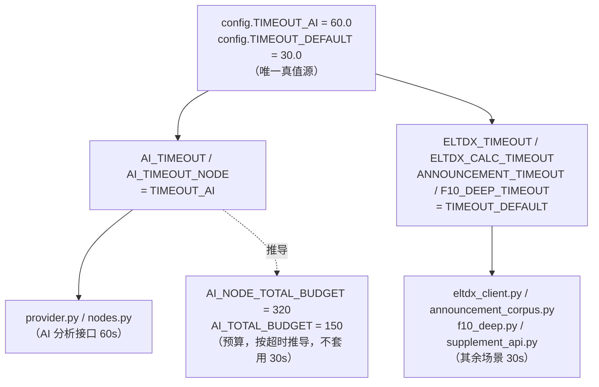

## 产品概述

对 ast-trader 项目做一次超时设置的集中化治理，消除散落的硬编码超时值，使全项目超时行为一致、可维护。

## 核心需求

1. **AI 分析接口超时统一为 60 秒** —— 凡是对 AI 分析接口发起的调用（增强模块调用与判断链五节点调用）都使用 60 秒。
2. **其它所有需要超时判断的场景统一为 30 秒** —— 行情主站连接、财务计算服务器、公告 PDF 下载、F10 深度查询、外部补充行情/资讯接口等。
3. **集中定义，禁止硬编码散落** —— 超时值只能有一个真值源，所有常量与调用处都从该真值源派生，不得在各处重复写死数值。
4. **全量检查并更新调用处** —— 保证 AI 分析接口走 60 秒、其余场景走 30 秒，行为一致且无遗留旧超时值。
5. **AI 总耗时预算不参与 30 秒统一**（用户已确认）—— 预算性质是"熔断"而非单次请求超时，按超时值推导得出，并在注释中写明它与超时的区别。

## 范围边界

- 仅涉及超时/耗时相关的数值治理，不改变任何业务逻辑、判断逻辑与调用顺序。
- `tests/test_data_health.py:52` 的 `raise TimeoutError("F10 股东减持查询超时")` 只是异常提示语、不含超时数值，不在改动范围内。

## 技术栈

- 语言：Python 3.11+（项目既有）
- 配置方式：项目既有 `config.py` 模块级常量（非 pydantic/env 配置对象），沿用该模式，不引入新配置框架

## 实现方案

### 核心策略：两级集中（总纲常量 → 场景常量 → 调用处）

新增**超时总纲**作为唯一真值源，所有场景常量由它派生，所有调用处只引用场景常量：

```python
# ─── 超时总纲（唯一真值源，禁止在别处写死数值）──────────────
TIMEOUT_AI = 60.0        # AI 分析接口：prompt 长且需输出推导，实测 8/25/30s 均不足
TIMEOUT_DEFAULT = 30.0   # 其它所有需要进行超时判断的场景
```

派生关系：

| 场景常量 | 值 | 派生自 | 调用处 |
| --- | --- | --- | --- |
| `AI_TIMEOUT` | 60.0 | `TIMEOUT_AI` | `provider.py:70` |
| `AI_TIMEOUT_NODE` | 60.0 | `TIMEOUT_AI` | `nodes.py:118` |
| `ELTDX_TIMEOUT` | 30.0 | `TIMEOUT_DEFAULT` | `eltdx_client.py:192` |
| `ELTDX_CALC_TIMEOUT` | 30.0 | `TIMEOUT_DEFAULT` | `eltdx_client.py:234` |
| `ANNOUNCEMENT_TIMEOUT` | 30.0 | `TIMEOUT_DEFAULT` | `announcement_corpus.py:216` |
| `F10_DEEP_TIMEOUT` | 30.0 | `TIMEOUT_DEFAULT` | `f10_deep.py:319` |
| `supplement_api` 三处 | 30.0 | `TIMEOUT_DEFAULT` | `supplement_api.py:18/58/96` |


### 预算：不纳入 30 秒统一，按超时推导（用户已确认）

预算与超时性质不同，必须显式区分并写进注释：

- `AI_NODE_TOTAL_BUDGET = 320.0` —— 判断链五节点**串行**执行（波次 ①③∥②④→⑤ 内按序调用），最坏耗时 = `TIMEOUT_AI × 5 + 余量 = 300 + 20`
- `AI_TOTAL_BUDGET = 150.0` —— 增强模块 6 个、`AI_MAX_CONCURRENCY = 3`，批次数 `ceil(6/3) = 2`，最坏耗时 = `2 × 60 + 30 余量`

注释必须写明：`TIMEOUT_*` 是**单次请求超时**，`*_TOTAL_BUDGET` 是**单只标的累计耗时熔断**；后者若套用 30 秒会导致判断链五节点必然熔断、永远走不到。

### 消除散落硬编码的两种形态

1. **字面量硬编码**：`supplement_api.py` 三处 `timeout=3.0 / 3.0 / 4.0` —— 改为 `timeout=config.TIMEOUT_DEFAULT`（该文件当前未 import config，需新增）。
2. **fallback 硬编码**：四处 `getattr(config, "X", 6.0/12.0/20/8.0)` —— 改为直接 `config.X`。理由：`config` 是本项目自带模块、常量必然存在，保留 fallback 等于制造**第二个真值源**，与"集中定义"目标直接冲突。

### 顺带修正（低风险，属"行为一致"范畴）

`provider.py:70` 现为 `timeout=timeout or config.AI_TIMEOUT`：`timeout=0` 会被 `or` 吞掉而误用默认值。改为 `timeout if timeout is not None else config.AI_TIMEOUT`，语义更严谨且不影响现有调用。

## 架构设计

超时值流向（单向派生，无反向依赖）：



## 目录结构

本次为纯配置治理，不新增文件，仅修改以下 6 个文件：

```
d:/workspace/ast-trader/
├── config.py                          # [MODIFY] 新增超时总纲 TIMEOUT_AI / TIMEOUT_DEFAULT；
│                                      #   6 个场景常量改为派生引用；AI_TIMEOUT 8.0→60、
│                                      #   AI_TIMEOUT_NODE 30.0→60；ELTDX/ELTDX_CALC/
│                                      #   ANNOUNCEMENT/F10_DEEP 全部→30；
│                                      #   两个 *_TOTAL_BUDGET 按超时推导（320 / 150）；
│                                      #   同步修正 L45、L50-51 引用旧值的注释
├── data/supplement_api.py             # [MODIFY] 新增 import config；
│                                      #   L18/L58/L96 三处 timeout=3.0/3.0/4.0
│                                      #   改为 config.TIMEOUT_DEFAULT
├── data/eltdx_client.py               # [MODIFY] L192、L234 去掉硬编码 fallback，
│                                      #   直接引用 config.ELTDX_TIMEOUT / config.ELTDX_CALC_TIMEOUT
├── data/announcement_corpus.py        # [MODIFY] L216 去掉 fallback 20，
│                                      #   直接引用 config.ANNOUNCEMENT_TIMEOUT
├── screener/f10_deep.py               # [MODIFY] L319 去掉 fallback 8.0，
│                                      #   直接引用 config.F10_DEEP_TIMEOUT
└── core/ai_coprocessor/provider.py    # [MODIFY] L70 `timeout or config.AI_TIMEOUT`
                                       #   改为 `timeout if timeout is not None else config.AI_TIMEOUT`
```

## 实施要点（防回归）

- **事实**：全局 `timeout` 命中仅 9 个文件；**测试中对任何超时数值均无断言**，改值不会触发回归失败。
- 改动后需跑全量测试确认无破坏；重点确认去掉 `getattr` fallback 后，没有测试通过 `delattr` 或构造空 config 依赖该 fallback。
- 判断链节点仅 `analyze` 单股路径调用，`screen` 全市场路径不受 60 秒影响。

## Agent Extensions

### SubAgent

- **code-explorer**
- 用途：在改动前对全仓做一次"超时类数值"兜底扫描，确认没有遗漏的硬编码时间限制（如 `sleep(`、重试退避、非 `.py` 配置文件中的超时字段、以及以毫秒/整数形式写死的等价超时）
- 预期产出：一份遗漏点清单（若无遗漏则明确回报"已穷尽"），确保"无遗留旧超时值"这条要求可被验证