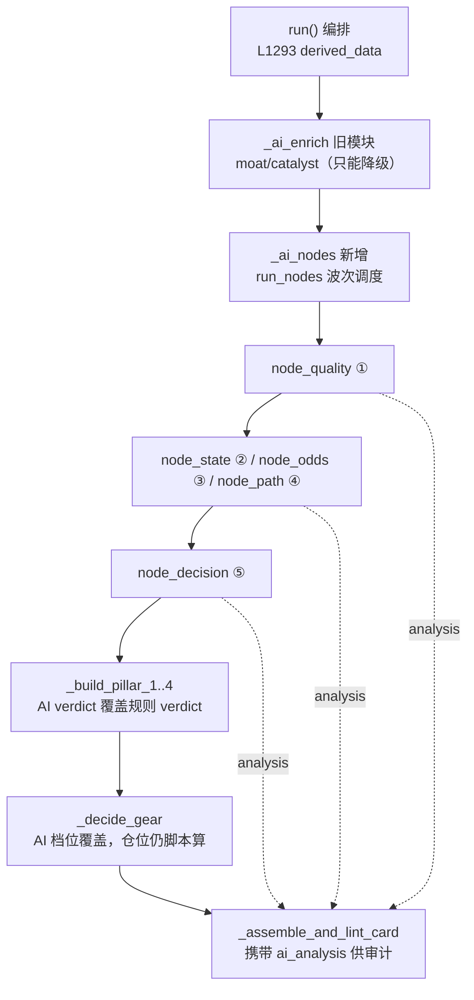

## 产品概述

把已经建好但**尚未接入**的判断链五节点调度器真正接进 `judgment_chain`，使报告的 ①②③④⑤ 与开头简报不再由 if-else 规则生成，而是由大模型依据判据手册分析数据后产出；规则判定退为 fallback。

## 核心需求

1. **五个支柱的 verdict 由模型产出** —— ①质地、②状态、③赔率、④路径、⑤决策档位，各自读取对应判据手册与完整数据面板后自行分析得出结论；规则版仅在模型未启用/调用失败/弃权时兜底。
2. **一处权威的下游产出由模型给** —— ②的临界点（该等什么）、④的左尾清单与证伪清单、⑤的裁决理由，均由模型产出并被下游引用，不再由规则硬编。
3. **开头简报随判定自动跟随** —— 简报与三段式结论由 verdict 派生（`format_three_part_conclusion`），verdict 改为模型产出后简报即随之改变，不另设规则分支。
4. **推导过程可审计** —— 模型的估值推导、左尾清单、证伪清单、子判定、封顶检查、裁决理由必须在报告上可见，作为"模型真的在分析"的证据。
5. **边界不可破** —— AI 关闭时行为与现状逐字一致；`screen` 全市场路径不触发节点（≤15s 验收）；旧模块（moat/catalyst/mainforce）维持「AI 只能降级」纪律；仓位百分比仍由脚本风控计算，模型只给档位。

## 范围边界

- 不改动五份判据手册内容（已按方法论重写完成）。
- 不改动 `position_cap` 的计算逻辑（风控边界，非判断）。
- 不改动 Lint 机检门控。

## 技术栈

- Python 3.11+，沿用项目既有 `config.py` 模块级常量与 `core/ai_coprocessor` 分层
- 判据以 Markdown 手册为业务资产（`core/ai_coprocessor/prompts/node_*.md`），与代码分离
- 模型输出经 `core/schemas/ai_enrichment.schema.json` 机检 + `guard` 取值域闸门

## 实现方案

### 核心策略：在 `run` 编排链上插入一次节点调用，逐支柱覆盖

现状编排（`core/judgment_chain.py`）：

```
L1293 derived_data = self.derived_calc.compute_metrics(...)
L1304 ai_map = self._ai_enrich(...)          ← 旧模块（只能降级）
L1313 _build_pillar_1_quality(...) -> quality_verdict
L1325 _build_pillar_2_state(...)   -> state_verdict, critical_wait
L1334 _build_pillar_3_odds(...)    -> odds_verdict
L1358 _build_pillar_4_path(...)    -> path_verdict
L1376 _decide_gear(...)            -> decision_gear
L1513 _assemble_and_lint_card(...)
```

改造后：

```
L1304 ai_map  = self._ai_enrich(...)   （不变，旧模块仍只能降级）
L1304+ node_map = self._ai_nodes(...)  ← 新增：五节点按波次调用，产出 verdict + analysis
L1313~ L1376 各 builder 接收 ai=node_map["node_*"]，AI verdict 覆盖规则 verdict
L1513        卡片携带 ai_analysis（推导过程）供审计
```

### 为什么在支柱构建**之前**跑节点

`run_nodes` 内部已实现上游波次依赖（①→②④→③→⑤）并自动把上游判定注入下游 ctx。若先跑规则支柱再跑节点，⑤就拿不到模型产出的②③④。因此节点链必须自包含地先跑完，再逐支柱覆盖。

### 为什么覆盖要落在 builder 内部而非 `run` 之后

支柱的 `verdict_desc` 与 verdict 强绑定（如 L509/512/515）。若在 `run` 之后只替换 verdict 而不动 desc，会出现「判 好、描述写欠佳」的自相矛盾。故每个 builder 增加可选 `ai` 入参，在内部先算规则 verdict，再用 AI verdict 覆盖并同步取对应 desc，并把 AI 的 `analysis` 作为首要解释。

### 数据供给

`build_node_context`（已建好）所需入参在 `run` 中于 L1304 处均具备：`quote`(L1214)、`momentum`(L1215)、`microstructure`(L1226)、`derived_data`(L1293)、`mainbz_list`、`flags`（脚本红旗）、`daily_df`(L1227) 可算 `kline_summary`。`peers` 若不可得则如实给「（未提供）」，**绝不伪造**。

### 回退与爆炸半径

- `AI_ENABLED` 默认 False（`config.py:31`）→ 默认路径 `node_map` 为空，543 基线测试行为不变
- 节点链受 `AI_NODE_TOTAL_BUDGET=320s` 熔断、`AI_TIMEOUT_NODE=60s` 单次超时
- 五个节点**各自独立**回退：某一节点弃权只回退该节点，不影响其余
- `screen` 路径需验证不调用 `run`（若调用则补显式开关）

## 架构设计



## 目录结构

```
d:/workspace/ast-trader/
├── core/judgment_chain.py                   # [MODIFY] 新增 _ai_nodes 方法（AI_ENABLED 门控，
│                                            #   内部调 run_nodes + build_node_context）；
│                                            #   _build_pillar_1_quality/_2_state/_3_odds/
│                                            #   _4_path 各增可选 ai 入参做 verdict 覆盖与
│                                            #   desc 同步；_decide_gear 增 ai 入参覆盖档位；
│                                            #   run 在 L1304 后调用 _ai_nodes 并向下传递
├── core/ai_coprocessor/context.py           # [MODIFY] 视接入需要微调 build_node_context
│                                            #   （kline_summary / peers / script_flags 适配
│                                            #    judgment_chain 现有入参）
├── core/ai_coprocessor/nodes.py             # [MODIFY] 视需要补充 budget 与 ctx 传递，
│                                            #   确保②的 critical_wait、④的 falsification
│                                            #   作为一处权威产出可被下游取用
├── core/schemas/                            # [MODIFY] 若决断卡新增 ai_analysis 字段，
│                                            #   按既有 schema 登记（additionalProperties:false）
└── tests/                                   # [MODIFY/NEW] 见下
```

## 实施要点（防回归）

- **事实基线**：`run_nodes` 当前无任何调用方；五支柱 verdict 为规则硬切（①质地是数 ✓/✗ 个数）；`AI_ENABLED` 默认 False；543 测试全绿、0 lint。
- 覆盖逻辑必须显式记录「本判定来自模型 / 来自规则」，便于排查。
- 旧模块继续 `_apply_ai` 只能降级；五节点是模型产出、规则兜底 —— 两套纪律需在代码注释里写清，避免后续误用。
- 不得让模型输出仓位百分比（`node_decision` 手册已定义该边界）。
- 日志：节点弃权沿用既有 `logger.info("AI[%s] 弃权: %s")` 口径，不打印大 payload。

## 关键代码结构

```python
# core/judgment_chain.py —— 新增方法骨架（签名级）
def _ai_nodes(
    self,
    ticker: str,
    name: str,
    derived_data: dict[str, Any],
    quote: dict[str, Any],
    microstructure: dict[str, Any] | None,
    mainbz_list: list[dict[str, Any]] | None,
    flags: list[RedFlagItem],
    kline_summary: str,
    peers: list[dict[str, Any]] | None = None,
) -> dict[str, Any]:
    """五节点判定层：AI 未启用/失败/弃权 → 返回空 dict，规则判定原样生效。"""
```

```python
# 支柱 builder 覆盖约定（签名级）：ai 为 None 或 ai.verdict 为空时保留规则 verdict
def _build_pillar_1_quality(..., ai: Any | None = None) -> tuple[str, str, list[dict[str, Any]]]
```

## Agent Extensions

### SubAgent

- **code-explorer**
- 用途：接线前确认两件事实 —— (1) `screen` 全市场路径是否调用 `JudgmentChain.run`（决定是否需要显式开关保护 ≤15s 验收）；(2) `build_node_context` 所需入参（`quote`/`microstructure`/`peers`/`kline_summary`/`script_flags`）在 `run` 的 L1304 处是否确实可取，取不到的是哪些
- 预期产出：明确的结论与行号证据，避免接线时才发现入参缺失或污染 screen 路径