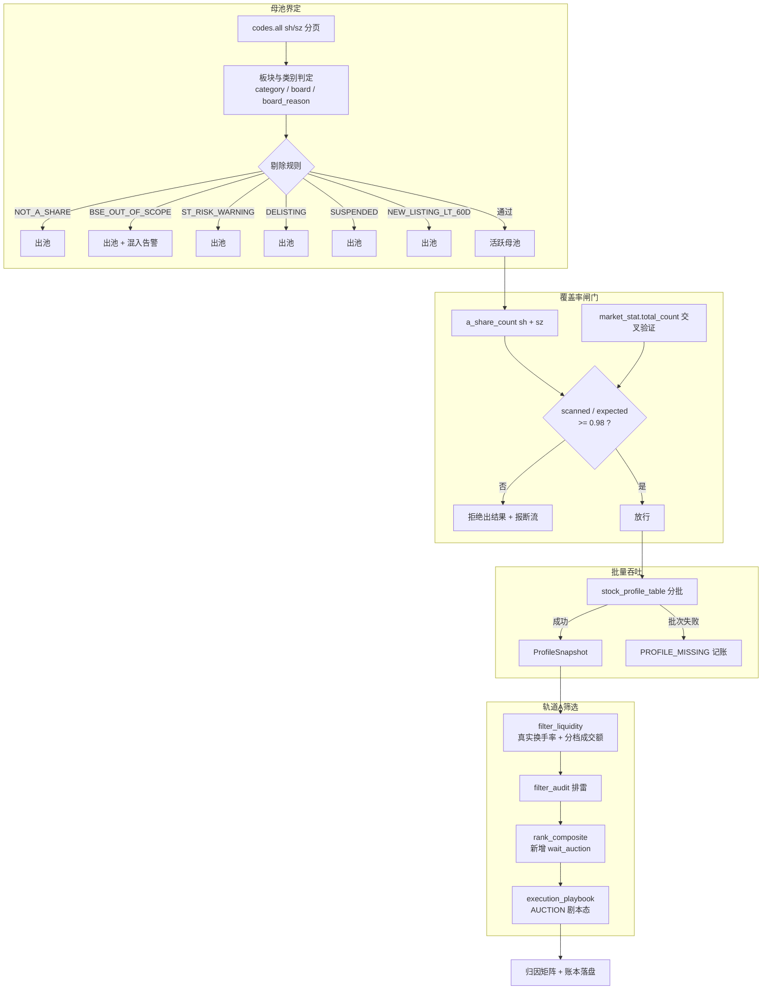

## 产品概述

将 `screen` 命令从「当日涨停天梯子集观察器」重构为**真正的沪深 A 股全市场筛选器**（第一批）。候选池由第三方涨停事件流改为本项目自主界定的沪深全量母池，并建立可证明「真跑了全市场」的覆盖率对账与淘汰归因机制，同时解开轨道 A 首板 0% 仓位死锁。

## 核心功能（第一批）

1. **沪深全量母池**：按 `codes.all(sh/sz)` 分页拉取代码表构建 universe；按 `category/board/board_reason` 精确判定板块与风险类别，剔除 ST/退市/停牌/次新（上市<60 交易日）；北交所显式排除（`BSE_OUT_OF_SCOPE`）并加混入告警。
2. **覆盖率对账闸门**：`expected = a_share_count('sh') + a_share_count('sz')`，与 `helpers.market_stat().total_count` 交叉验证；`scanned/expected < 0.98` 时拒绝输出结果并报断流。
3. **批量吞吐**：改用 `helpers.stock_profile_table` 分批拉取（一次拿到换手率/总市值/流通市值/上市日期/板块），批大小进 config；失败批次记 `PROFILE_MISSING`，**绝不静默缩小母池**。
4. **淘汰归因矩阵**：每层 `input = Σ dropped_by_reason + output` 强制守恒；新增「某规则淘汰数恒为 0」的死代码告警（用于自动暴露换手率门槛失效类问题）。
5. **轨道 A 首板解锁**：首板涨停不再因「涨停=涨幅过大」被判 `wait_pullback` 归零，改为 `wait_auction` 态——给出次日 9:25 竞价确认条件（高开≥2% 且竞价量≥昨日 15% 方可参与，低开废单）与试错仓位。
6. **数据纪律修复**：`momentum_proxy` 量比硬编码 1.5 改为真实值/未核验；`is_gem_star` 补 689；`terminal_view` 梯队与仓位恒显示默认值的 bug 修复。

## 边界（本批不做）

轨道 B 弱转强/首阴反包池、轨道 C 产业中军、轨道 D 困境反转（第三批）；机构持股占比（无数据通道，已确认降级为代理指标，第三批再做）；北交所（永久排除）。

## 技术栈

沿用项目现有技术栈，不引入新依赖：

- Python 3.11 + `dataclasses` / `concurrent.futures`（项目既有并发范式）
- 数据层 `eltdx`（`client.codes` / `client.helpers.stock_profile_table` / `client.helpers.market_stat` / `client.helpers.shortline_indicators`）
- 连接与重试复用 `data/eltdx_client.py` 的 `open_client()` / `with_retry()` / `normalize_code()`
- 健康度复用 `data/data_health.py` 的 `DataHealthTracker`
- 测试 pytest（387 项基线，376 离线 + 11 `seednet`）

## 实现思路

### 核心策略

把「universe 来源」从 `F10.limit_board_ladder()` 换成**自主界定的沪深代码表**，`limit_board_ladder` 角色降级为「轨道 A 的连板身位与题材上下文增强器」，不再决定谁能进池。

关键决策与权衡：

1. **阶段1 用 `stock_profile_table` 而非 `get_snapshots`**——实测 `QuoteSnapshot` 无 `turnover_ratio` / `total_mv`，沿用会让换手率门槛二次死亡（这正是当前 bug 根因）。`StockProfile` 一次给出 `turnover_rate / total_market_value / circulating_market_value / ipo_date / board / category`。
2. **覆盖率闸门优先于一切**——宁可拒绝出结果，也不输出残缺的「精选池」。这是「全市场」可信度的唯一硬保证。
3. **批次失败 = 标记 MISSING，不剔除**——区分「数据不可得」与「规则判定不合格」，符合 NFR-02。
4. **首板解锁用第五态 `wait_auction` 而非直接给 BUY**——保留「当日不追高」的风控内核，把决策权交给次日可验证的竞价条件，避免从「一律 0 仓」滑向「一律满仓」。
5. **`limit_board_ladder` 保留**——它提供的 `board_level` / `limit_reason` / 题材聚合是当前唯一可得的连板与题材源，直接丢弃会损失轨道 A 的核心特征。

### 性能与复杂度

- 母池构建：`codes.all` 分页 1600/页，沪深合计约 4 页 × 2 市场 = 约 8 次 I/O，可当日缓存。
- Profile 吞吐：约 5100 只 / 批大小（先 50，压测后调大）= 约 102 批。**这是主要耗时点**，需实测单次上限与截断行为；失败批次用 `with_retry` 覆盖。
- 后续重数据（F10 治理、资金流、财务）只对 Tier 1 存活集（预期数百只）执行，绝不对 5100 只全量调用。
- 复杂度：母池构建 O(N)；归因矩阵 O(N)；整体无 N+1 网络调用（全部批量）。

## 执行要点

- **先读后改**：改 `rank_composite.momentum_proxy` 前必须先读 `core/youzi_personas.py:extract_tape_features`，确认 `volume_ratio` 是否容忍 `None`；不容 `None` 时改为「真实代理值 + `volume_ratio_unverified` 标记 + warning」，严禁静默保留 1.5。
- **守恒断言**：归因矩阵每层 `assert input == Σ dropped + output`，测试必须覆盖。
- **死代码告警需白名单**：部分规则本就可能为 0（如 `BSE_OUT_OF_SCOPE` 在纯沪深数据下应为满额剔除而非 0），告警只对「预期会触发但为 0」的规则生效，白名单进 config。
- **向后兼容**：`filter_liquidity` 的 `min_amount` / `min_pct` 入参保留；`rank_composite` 的 `action` 取值新增 `wait_auction`，既有 `buyable / wait_pullback / wait_reseal / watch_only` 四态语义与既有测试不得改变。
- **日志**：复用 `logger.info` 输出母池对账行；失败批次用 `DataHealthTracker.record_failure`，避免日志刷屏。
- **blast radius**：本批不改动 `filter_audit`（上一批刚修复）、不改动 `judgment_chain` / `audit_engine` / `derivation`。

## 架构设计



## 目录结构

```
ast-trader/
├── config.py                          # [MODIFY] 新增「沪深全市场母池」与「轨道A竞价确认」配置段：
                                       #   UNIVERSE_MARKETS / UNIVERSE_CODE_PAGE_SIZE /
                                       #   UNIVERSE_PROFILE_BATCH_SIZE / UNIVERSE_MIN_COVERAGE_RATIO /
                                       #   UNIVERSE_NEW_LISTING_MIN_DAYS / UNIVERSE_EXCLUDE_ST /
                                       #   UNIVERSE_EXCLUDE_SUSPENDED / UNIVERSE_DEAD_RULE_WHITELIST /
                                       #   AUCTION_MIN_OPEN_PCT / AUCTION_MIN_VOLUME_RATIO /
                                       #   AUCTION_TRIAL_POSITION_PCT
├── screener/
│   ├── universe.py                    # [NEW] 沪深全量母池构建器。职责：codes.all 分页拉取；
│   │                                  #   按 category/board/board_reason 判定板块与风险类别；
│   │                                  #   按 reason_code 剔除并计数；北交所显式排除 + 混入告警；
│   │                                  #   a_share_count 与 market_stat 交叉验证并给出 coverage_ok
│   ├── profile_batch.py               # [NEW] stock_profile_table 批量吞吐器。职责：分批调用、
│   │                                  #   with_retry 包裹、失败批次记 PROFILE_MISSING、
│   │                                  #   缺字段置 None（严禁 or 0.0）、返回统计字典
│   ├── funnel_audit.py                # [NEW] 淘汰归因矩阵。职责：按层记录 input/dropped/output、
│   │                                  #   守恒断言、死代码规则检测、终端面板渲染数据
│   ├── pipeline.py                    # [MODIFY] 编排层重构：Step0 建池 + 闸门 → Step1 profile 吞吐
│   │                                  #   → Step2 ladder 降级为轨道A增强源 → Step3 liquidity
│   │                                  #   → Step4 audit → Step5 rank → Step6 账本；_fetch_quotes_map
│   │                                  #   由 profile_batch 取代
│   ├── filter_liquidity.py            # [MODIFY] 换手率改读真实值；is_gem_star 补 689；北交所显式
│   │                                  #   排除分支；每个剔除点写入 reason_code 并回传归因
│   ├── rank_composite.py              # [MODIFY] 新增 wait_auction 第五态解首板死锁；momentum_proxy
│   │                                  #   量比去伪造；保留既有四态语义
│   └── ladder_analyzer.py             # [MODIFY] 轻量：暴露 broken_rows（供第二批轨道B）与题材映射，
                                       #   不再作为唯一 universe 来源
├── core/
│   └── execution_playbook.py          # [MODIFY] 新增 AUCTION 剧本态：base=0、试错仓=AUCTION_TRIAL_
                                       #   POSITION_PCT、entry_tactic 写明竞价条件、invalidation 写明低开废单
├── presentation/
│   └── terminal_view.py               # [MODIFY] 修 card/ladder_info 恒取默认值导致梯队显示「首板/潜伏」
                                       #   与仓位恒 0% 的 bug；新增母池对账面板
└── tests/
    ├── test_universe.py               # [NEW] 母池界定（ST/退市/停牌/次新/基金/北交所样本）、
                                       #   覆盖率闸门拒绝出结果、归因守恒
    ├── test_profile_batch.py          # [NEW] 批次失败记 MISSING 不缩池、缺字段置 None
    └── test_screener.py               # [MODIFY] 追加：首板→wait_auction、换手率真实值生效（证明死代码
                                       #   已修）、689 按双创门槛、既有四态不回归

## 关键代码结构

```

# screener/universe.py —— 母池构建结果契约

@dataclass(frozen=True)
class UniverseRow:
code: str            # 六位裸码
full_code: str       # sh600519 / sz000333
name: str
exchange: str        # "sh" | "sz"
board: str | None            # 代码表 board
category: str | None         # 代码表 category
board_reason: str | None     # 含 ST / 退市 / 次新 等判定依据
ipo_date: str | None
pre_close: float | None

@dataclass
class UniverseBuildResult:
rows: list[UniverseRow]
expected_total: int              # a_share_count("sh") + a_share_count("sz")
scanned_total: int
market_stat_total: int | None    # helpers.market_stat().total_count，仅交叉验证
excluded: dict[str, int]         # reason_code -> count
bse_intrusion: list[str]         # 防御：混入的北交所代码
warnings: list[str]

@property
def coverage_ratio(self) -> float: ...
@property
def coverage_ok(self) -> bool: ...   # coverage_ratio >= config.UNIVERSE_MIN_COVERAGE_RATIO

```
```

# screener/funnel_audit.py —— 归因矩阵契约

@dataclass
class StageAudit:
stage: str                    # "L0_universe" | "L1_profile" | "T1_liquidity" | "T2_audit" | "T3_rank"
input_count: int
dropped: dict[str, int]       # reason_code -> count
output_count: int

@property
def conserved(self) -> bool:  # input_count == sum(dropped.values()) + output_count

def dead_rules(audits: list[StageAudit], whitelist: frozenset[str]) -> list[str]: ...
"""返回「预期触发但淘汰数为 0」的规则 —— 用于自动暴露换手率门槛失效类死代码。"""

```
```

# screener/profile_batch.py —— 批量吞吐契约

def fetch_profiles(
full_codes: list[str],
*,
batch_size: int | None = None,      # 默认 config.UNIVERSE_PROFILE_BATCH_SIZE
) -> tuple[dict[str, ProfileSnapshot], dict[str, int]]:
"""返回 (full_code -> ProfileSnapshot, stats)

stats 键：requested / returned / missing / failed_batches
★ 缺失字段一律 None；批次失败对应 code 不出现在返回值中，
由调用方按 stats["missing"] 计入覆盖率缺口，严禁静默缩小母池。
"""
```

## Agent Extensions

### Skill

- **eltdx-codes**
- 用途：核对 `client.codes.all/all_a_shares/a_share_count/latest_st/latest_suspended` 的确切入参、分页语义与 `SecurityCode.category/board/board_reason` 取值域
- 预期产出：母池界定与覆盖率对账基准的实现准确无误，板块与 ST 判定不靠名称猜测
- **eltdx-helpers-shortline**
- 用途：核对 `client.helpers.stock_profile_table` 的批次上限、返回字段与 `shortline_indicators` 的量比代理字段（`open_prev_amount_ratio` / `auction_prev_volume_ratio`）
- 预期产出：确定 `UNIVERSE_PROFILE_BATCH_SIZE` 取值，并为 `momentum_proxy` 量比去伪造找到真实代理来源
- **eltdx-helpers-rank**
- 用途：核对 `client.helpers.market_stat()` 的统计口径（是否含北交所），确定其能否作为硬断言或仅作交叉验证告警
- 预期产出：覆盖率闸门的交叉验证规则安全落地，不产生系统性误报

### SubAgent

- **code-explorer**
- 用途：改动 `rank_composite.momentum_proxy` 与 `execution_playbook` 前，复核 `extract_tape_features`、`PlaybookBuilder.build`、`record_screen_picks`、`terminal_view` 渲染的全部调用点与既有测试断言
- 预期产出：改动面闭合，无遗漏调用点，既有 387 项测试不回归