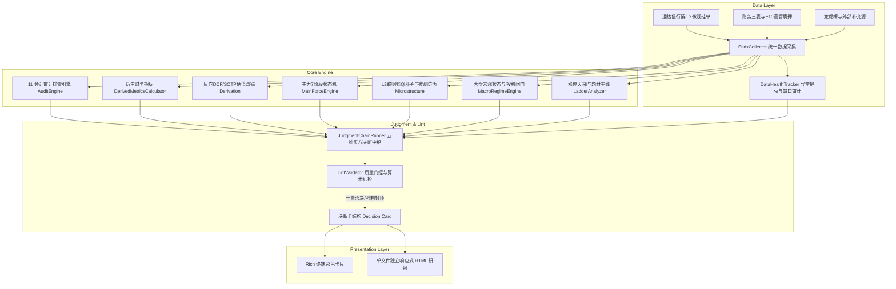
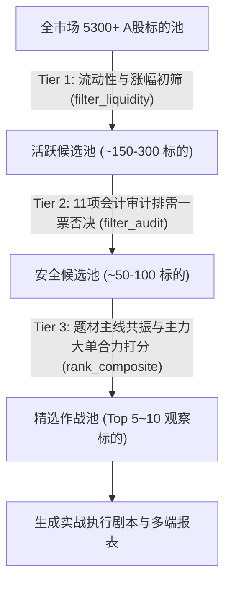

# AST-Trader 系统架构设计与数据流转规格说明

本文档详细描述 **AST-Trader（A股短线与买方量化投研系统）** 的整体系统架构、内部模块交互、数据流转链路与质量风控机制。

---

## 1. 架构总览与设计原则

AST-Trader 采用 **「自底向上、确定性量化、因果闭环」** 的多层解耦架构设计：



### 核心设计原则：
1. **纯确定性与零幻觉**：计算逻辑、财务指标、盘口因子与估值双锚全部由 Python 本地代码计算，杜绝大模型在数值计算上的幻觉与前后矛盾。
2. **严禁静默 Pass（No Silent Pass）**：所有数据通道必须显式捕获并追踪调用状态，接口故障时记录完整堆栈与业务影响，在终端与报告中显性披露“信息缺口”。
3. **单点真理与因果闭环（Single Source of Truth）**：
   * “贵不贵”全报告仅在支柱 ❸ 回答；
   * “该等什么”全报告仅在支柱 ❷ 给出唯一锚点；
   * 仓位建议与行动档位仅在支柱 ❺ 出现；
   * 致命审计红旗具备绝对一票否决权，不可被任何美好愿景稀释。

---

## 2. 数据采集与链路健康度审计 (Data Layer)

### 2.1 数据通道矩阵
| 通道名称 | 数据源/协议 | 提取内容 | 降级处理 |
| :--- | :--- | :--- | :--- |
| **实时行情与分时** | `eltdx` TCP | 现价、涨跌幅、换手率、总市值、流通市值、PE/PB | 阻断（核心必要数据） |
| **十档微观盘口** | `eltdx` L2 | 委买/委卖十档深度、挂单笔数、算法拆单特征 | 降级为常规分时量比，记录缺口 |
| **财务三表** | `eltdx.f10` | 近 5 期资产负债表、利润表、现金流量表 | 降级采用估算快报，质地五问降级 |
| **公司治理与概念** | `eltdx.f10` | 大股东质押率、增减持计划、主营业务分部、所属概念 | 减持未核验时质地五问 Q4 强制警示 |
| **全市场天梯与广度** | `eltdx` / 市场统计 | 当日全部涨停/炸板/跌停标的、指数动量、全市场涨跌家数 | 宏观状态降级为基础情绪标签 |
| **龙虎榜席位** | 外部补充 API | 营业部买卖席位、净买入额、机构专用席位 | 空数据（非上榜日）标记为真实空集 |

### 2.2 数据健康度追踪机制 (`data_health.py`)
每个数据通道的调用必须产生 `InterfaceCallRecord`：
* `SUCCESS`：接口联通，获取非空记录，记录数量；
* `EMPTY`：接口正常响应，但客观无数据（如当日非龙虎榜股票）；
* `FAILED`：捕获完整 Python 异常，提取 `error_type`、`error_message` 和 `trace_snippet`。

数据缺口向上穿透机制：
```python
# 示例：减持计划接口异常时，决策链主动感知并联动
if any("减持" in n for n in failed_names):
    if j_mgmt == "✓":
        j_mgmt = "⚠️"
    ev_mgmt += " (⚠️ 减持计划接口取数异常，在途减持暂无法核验)"
```

---

## 3. 核心计算中台与模型规格 (Core Engine)

### 3.1 首页「赚不赚钱」数据看板 (`derived_metrics.py`)
计算 5 大核心财务衍生指标，并生成 Unicode Sparkline 紧凑走势：
1. **毛利率 / 净利率**：穿透营业成本与主业实际留存能力；
2. **现金含量（经营现金流 OCF / 净利润）**：识别“纸面富贵”，$OCF/NI < 0.5$ 触发造血贫血警示；
3. **净资产收益率（ROE）与 DuPont 归因**：计算近 5 期 ROE 复合趋势，拆解为净利润率 $\times$ 资产周转率 $\times$ 权益乘数；
4. **主营业务侵蚀度**：投资收益与公允价值变动占营业利润比例，$\ge 50\%$ 提示投资收益严重扭曲主业；
5. **自由现金流（FCF）收益率**：$FCF = OCF - \text{资本开支}$，衡量重资产扩张与再投资消耗。

### 3.2 估值双锚与叙事溢价拆解 (`derivation.py`)
* **$P = F + N$ 模型**：
  * $F$（基本面底座）：基于 SOTP 分部估值或清算底座价值；
  * $N$（叙事溢价）：当前股价减去底座，即市场为“题材与未来想象”支付的期权对价。
* **反向 DCF 逆推**：
  * 给定当前市值，在基准折现率（$WACC$）与终值倍数下，反推市场定价隐含的未来 3 年复合营收增速（Implied CAGR）与稳定期净利率（Implied Margin）。
* **10 项严格算术闭环检查 (`check()`)**：
  * 验证市值得出、底座减项、叙事溢价、股价区间与左尾深度的数学逻辑一致性，误差容差严格控制在半个 ULP（浮点机器精度）。

### 3.3 主力行为 7 阶段状态机与微观盘口 (`main_force_engine.py` & `microstructure.py`)
* **7 阶段生命周期**：
  $$\text{阶段} \in \{\text{试盘探路}, \text{隐蔽吸筹}, \text{控盘锁仓}, \text{健康放量主升}, \text{高位出货震荡}, \text{诱多派发}, \text{冰点存量震荡}\}$$
* **微观防伪指标**：
  * **高频聪明的钱 $Q$ 因子**：通过委托单笔挂单规模与主动成交方向，计算知情资金的主动买入效率；
  * **对倒与算法拆单穿透**：识别大单假挂诱多、撤单比率异动与假突破形态；
  * **筹码沉淀承载**：获利盘比例与跌回保守底座的左尾风险深度。

### 3.4 宏观大盘与全市场情绪闸门 (`macro_regime.py` & `ladder_analyzer.py`)
* **基准大盘趋势**：上证指数 / 深证成指均线结构（MA5/MA20）、连跌天数与短期动量；
* **市场广度与量能**：全市场涨跌比（Breadth Ratio）、全市场总成交额（万亿级量能分级）；
* **投机情绪闸门**：空间板高度、核心题材涨停晋级率、炸板率与跌停家数。当跌停 $\ge 15$ 家或处于退潮混沌期时，**强制收紧投机闸门，限制题材股买入档位**。

---

## 4. 全市场三层漏斗筛选器 (`screener/`)

针对全市场 5300+ 标的，在盘中或盘后 15 秒内完成层层收敛：



1. **Tier 1 流动性初筛**：日成交额 $\ge 5$ 亿、换手率 $8\% \sim 25\%$、日内涨幅位于博弈活跃区间（$4.5\% \sim 10\%$）；
2. **Tier 2 审计一票否决**：命中造假（Beneish $M > -1.78$）、大股东高质押（$\ge 50\%$）、在途巨额减持、立案调查红旗者直接剔除；
3. **Tier 3 题材合力打分**：基于连板梯队身位、龙一溢价、微观 $Q$ 因子与主力大单净流入复合排序。

---

## 5. 质量门控与机检 (Lint Validator)

* 位于 `lint/validator.py`。
* **致命红旗硬封顶**：一旦标的触发 🔴 致命红旗，无论技术指标或题材多么诱人，系统强制重写决断档位为 `【回避】`，建议仓位上限强制置 `0%`。
* **单点真理核验**：确保决策卡内各节点不发生自相矛盾（如支柱 ❶ 判定质地极差但在支柱 ❺ 推荐重仓买入）。

---

## 6. 系统非功能特性 (Non-Functional Specifications)

1. **执行速度**：单股全套深度体检与 15+ 接口采集装配 $\le 2.0$ 秒；全市场漏斗筛选 $\le 15$ 秒。
2. **内存消耗**：常驻运行内存 $< 500\text{MB}$，无重度外部依赖或后台常驻守护大模型。
3. **可维护性**：核心算法与规则 100% 具备单测覆盖（当前 56 项自动化测试全绿）。
