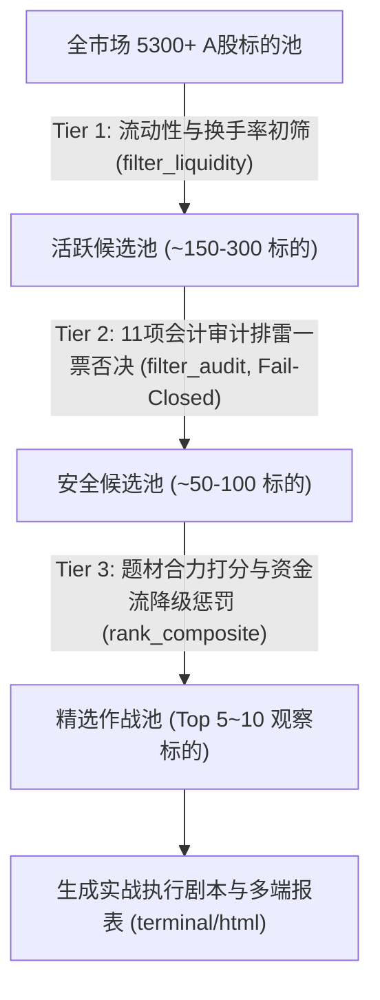

# AST-Trader 系统架构设计与数据流转规格说明

本文档详细描述 **AST-Trader（A股短线与买方量化投研系统）** 的整体系统架构、内部模块交互、数据流转链路与质量风控机制。

> **版本演进说明**：根目录下的 `ARCHITECTURE_AND_SRS.md` 为项目初期的 v1.0 历史基线需求文档；当前 `docs/ARCHITECTURE.md` 是与实际生产代码完全对齐的**鲜活权威系统架构说明**。

---

## 1. 架构总览与设计原则

AST-Trader 采用 **「自底向上、确定性量化、因果闭环」** 的多层解耦架构设计：

```mermaid
flowchart TD
    subgraph 数据底座层 [Data Layer]
        TH[tdx_hosts 7709 主站四级优先级与容灾] --> D1
        D1[通达信行情/L2微观挂单 eltdx] --> DC[EltdxCollector 统一数据采集]
        D2[财务三表与F10概念/减持/违规处罚] --> DC
        D3[龙虎榜与外部补充源] --> DC
        D4[定期报告与公告 PDF 语料] --> DC
        DC --> DH[DataHealthTracker 异常捕获与缺口审计]
    end

    subgraph 核心计算与特征层 [Core Engine]
        DC --> C1[12 个会计审计排雷模型 AuditEngine]
        DC --> C2[衍生财务指标 DerivedMetricsCalculator]
        DC --> C3[反向DCF/SOTP估值双锚 Derivation]
        DC --> C4[主力7阶段状态机 MainForceEngine]
        DC --> C5[L2聪明钱Q因子与微观防伪 Microstructure]
        DC --> C6[大盘宏观状态与投机闸门 MacroRegimeEngine]
        DC --> C7[涨停天梯与题材主线 LadderAnalyzer]
        DC --> C8[24 大游资战法画像 YouziPersonas + SeatMatcher 席位匹配]
        DC --> C9[杀猪盘 8 维舆情雷达 TrapDetector]
        DC --> C10[短线博弈量价 GameFeatures / 资金矩阵 CapitalMatrix / 投资者结构 InvestorPanel]
        DC --> C11[行业准入识别器 Industry（当前仅「金融 / 未分类」）]
    end

    subgraph 决断合成层 [Judgment & Lint]
        C1 & C2 & C3 & C4 & C5 & C6 & C7 & C8 & C9 & C10 & C11 --> JC[JudgmentChainRunner 五维买方决断中枢]
        DH --> JC
        JC --> EP[ExecutionPlaybook T+1 持币/持股双轨作战剧本]
        AIC[AI 语义协处理器 core/ai_coprocessor 单向阀] -.->|只加风险/只能降级, 默认关闭| JC
        JC --> VL[LintValidator 质量门控与算术机检 (叶子层, 16 条规则)]
        VL -->|以纠代抛: 降级观察 + 仓位清零| CARD[决断卡结构 Decision Card]
        CARD --> SV[JSON-Schema 契约校验 Draft202012Validator]
    end

    subgraph 表现输出层 [Presentation Layer]
        CARD --> PL[PlainLanguage 白话翻译 (只读, 绝不回写决断卡)]
        PL --> TV[Rich 终端彩色卡片]
        PL --> HR[单文件独立响应式 HTML 研报]
    end
```

> ⚠️ **数据源现实（切勿按图索骥）**：`eltdx` F10 **无控股股东股权质押通道**、
> **无公司业绩预告通道**。`pledge_ratio` 恒为 `None`、`gov["forecast"]` 无生产者，
> 故 `PLEDGE_FATAL_RATIO`（>70% 致命）与 `FORECAST_DROP_FATAL_RATIO`（腰斩致命）
> 两条排雷规则在真实跑批中**恒定不触发**，属「规则就绪但数据源断流」。
> 现行替代维度：监管违规处罚记录 + 「未核验即降权」。
>
> ⚠️ **架构图留白**：行业/板块相对强弱（`core/sector_rs.py`）、龙虎榜协同图谱
> （`core/lhb_synergy.py`）、实盘回测（`screener/backtester.py`）均未实施，
> 详见 `docs/UNIMPLEMENTED_WORKLIST.md`。

### 核心设计原则：
1. **纯确定性与零幻觉**：计算逻辑、财务指标、盘口因子与估值双锚全部由 Python 本地代码计算，杜绝大模型在数值计算上的幻觉与前后矛盾。
2. **严禁静默 Pass 与禁止伪造默认值（Fail-Closed 买方纪律）**：
   * 所有数据通道必须显式捕获并追踪调用状态，接口故障时记录完整堆栈与业务影响；
   * 严禁在财报缺失时捏造虚拟数字（如捏造 0.1 亿净利润倒推假估值）；
   * 数据缺失时必须显式标注 `未核验(财务缺失)` 或 `未核验(微观缺失)`，并强制清零建议仓位。
3. **单点真理与因果闭环（Single Source of Truth）**：
   * “好不好（质地五问）”全报告仅在支柱 ❶ 回答；
   * “在变好吗（跃迁 $\lambda$）”与“该等什么”全报告仅在支柱 ❷ 给出唯一锚点；
   * “贵不贵（双锚估值）”全报告仅在支柱 ❸ 回答；
   * “主力与路径”全报告仅在支柱 ❹ 呈现；
   * 仓位建议与行动档位仅在支柱 ❺ 出现；
   * 致命审计红旗具备绝对一票否决权，不可被任何题材或连板所稀释。
4. **单向依赖与高内聚解耦**：
   * `lint/` 作为纯叶子层，严禁反向依赖 `core/` 业务逻辑；
   * `JudgmentChainRunner` 将庞大的流水线解耦拆分为 **6 个独立装配方法** —— 4 大支柱装配器（`_build_pillar_1_quality` ~ `_build_pillar_4_path`）、纯决策函数（`_decide_gear`）与装配+门控（`_assemble_and_lint_card`），杜绝上帝方法。

---

## 2. 数据采集与链路健康度审计 (Data Layer)

### 2.1 数据通道矩阵
| 通道名称 | 数据源/协议 | 提取内容 | 降级处理 |
| :--- | :--- | :--- | :--- |
| **实时行情与分时** | `eltdx` TCP (连接池轮询容灾) | 现价、涨跌幅、换手率、总市值、流通市值、PE/PB | 阻断（核心必要数据） |
| **十档微观盘口** | `eltdx` L2 | 委买/委卖十档深度、挂单笔数、算法拆单特征 | 降级为 `STAGE_UNVERIFIED`，仓位清零 |
| **财务三表** | `eltdx.f10` | 近 5 期资产负债表、利润表、现金流量表 | 缺失时标注 `未核验(财务缺失)`，估值双锚不予计算 |
| **公司治理与概念** | `eltdx.f10` | 大股东质押率、增减持计划、主营业务分部、所属概念 | 减持未核验时质地五问 Q4 强制警示 |
| **全市场天梯与广度** | `eltdx` / 市场统计 | 当日全部涨停/炸板/跌停标的、指数动量、全市场涨跌家数 | 宏观状态降级为基础情绪标签 |
| **龙虎榜席位** | 外部补充 API | 营业部买卖席位、净买入额、机构专用席位 | 空数据（非上榜日）标记为真实空集 |

### 2.2 数据健康度追踪机制 (`data_health.py`)
每个数据通道的调用必须产生 `InterfaceCallRecord`：
* `SUCCESS`：接口联通，获取非空记录，记录数量；
* `EMPTY`：接口正常响应，但客观无数据（如当日非龙虎榜股票）；
* `FAILED`：捕获完整 Python 异常，提取 `error_type`、`error_message` 和 `trace_snippet`。

数据缺口向上穿透机制：
```python
# 示例：减持计划接口异常时，决策链主动感知并联动
if any("减持" in n for n in failed_names):
    if j_mgmt == "✓":
        j_mgmt = "⚠️"
    ev_mgmt += " (⚠️ 减持计划接口取数异常，在途减持暂无法核验)"
```

---

## 3. 核心计算中台与模型规格 (Core Engine)

### 3.1 首页「赚不赚钱」数据看板 (`derived_metrics.py`)
计算 5 大核心财务衍生指标，并生成 Unicode Sparkline 紧凑走势：
1. **毛利率 / 净利率**：穿透营业成本与主业实际留存能力；
2. **现金含量（经营现金流 OCF / 净利润）**：识别“纸面富贵”，$OCF/NI < 0.5$ 触发造血贫血警示；
3. **净资产收益率（ROE）与 DuPont 归因**：计算近 5 期 ROE 复合趋势，拆解为净利润率 $\times$ 资产周转率 $\times$ 权益乘数；
4. **主营业务侵蚀度**：投资收益与公允价值变动占营业利润比例，$\ge 50\%$ 提示投资收益严重扭曲主业；
5. **自由现金流（FCF）收益率**：$FCF = OCF - \text{资本开支}$，衡量重资产扩张与再投资消耗。

### 3.2 估值双锚与叙事溢价拆解 (`derivation.py`)
* **$P = F + N$ 模型**：
  * $F$（基本面底座）：基于 SOTP 分部估值或清算底座价值；
  * $N$（叙事溢价）：当前股价减去底座，即市场为“题材与未来想象”支付的期权对价。
* **反向 DCF 逆推**：
  * 给定当前市值，在基准折现率（$WACC$）与终值倍数下，反推市场定价隐含的未来 3 年复合营收增速（Implied CAGR）与稳定期净利率（Implied Margin）。
* **核验纪律与算术闭环**：
  * 若财务数据缺失导致净利润不可得，严格输出 `未核验(财务缺失)`，`derivation` 与 `anchor_range` 均置为 `None`，仓位强制清零；
  * 具备完整数据时执行 10 项严格算术闭环检查 (`check()`)。

### 3.3 主力行为 7 阶段状态机与微观盘口 (`main_force_engine.py` & `microstructure.py`)
* **生命周期枚举与状态持久化**：
  $$\text{阶段} \in \{\text{STAGE\_1\_ACCUMULATION}, \text{STAGE\_2\_WASHOUT}, \dots, \text{STAGE\_7\_PASSIVE\_DRIFT}, \text{STAGE\_UNVERIFIED}\}$$
  * 支持多日跨周期状态机持久化至 `config.CACHE_DIR / "mainforce_history_state.json"`；
  * 当由 `STAGE_UNVERIFIED` 恢复为真实阶段时，历时计数（`days_in_stage`）重置为 0，防止错误继承未核验周期。
* **微观防伪指标**：
  * **高频聪明的钱 $Q$ 因子**：通过委托单笔挂单规模与主动成交方向，计算知情资金的主动买入效率；
  * **对倒与算法拆单穿透**：识别大单假挂诱多、撤单比率异动与假突破形态；
  * **筹码沉淀承载**：获利盘比例与跌回保守底座的左尾风险深度。

### 3.4 宏观大盘与全市场情绪闸门 (`macro_regime.py` & `ladder_analyzer.py`)
* **基准大盘趋势**：上证指数 / 深证成指均线结构（MA5/MA20）、连跌天数与短期动量；
* **市场广度与量能**：全市场涨跌比（Breadth Ratio）、全市场总成交额（万亿级量能分级）；
* **投机情绪闸门**：空间板高度、核心题材涨停晋级率、炸板率与跌停家数。当跌停 $\ge 15$ 家或处于退潮混沌期时，**强制收紧投机闸门，限制题材股买入档位**。

---

## 4. 全市场三层漏斗筛选器 (`screener/`)

针对全市场 5300+ 标的，在盘中或盘后 15 秒内完成层层收敛：



1. **Tier 1 流动性初筛 (`filter_liquidity.py`)**：
   * 成交额硬门槛：主板 $\ge 5$ 亿，双创板（创业板/科创板） $\ge 3$ 亿；
   * 换手率区间：$7.0\% \le \text{换手率} \le 28.0\%$（过低缺乏资金博弈，过高存在高位出货派发嫌疑）；
   * 涨幅活跃区间：通常位于 $4.5\% \sim 10.0\%$；
   * 特殊豁免：巨量封单涨停（一字板）享受封单额豁免通道。
2. **Tier 2 审计一票否决 (`filter_audit.py`)**：
   * 严格贯彻 **Fail-Closed** 买方风控：排雷异常或无法核验直接剔除，仅当核验通过标记为 `audit_status = "VERIFIED_SAFE"`；
   * 命中造假（Beneish $M > -1.78$）、大股东高质押（$\ge 70\%$ 致命 / $\ge 50\%$ 高危）、在途巨额减持、立案调查红旗者直接一票剔除。
3. **Tier 3 题材合力打分 (`rank_composite.py`)**：
   * 连板分数均衡封顶：$\min(\text{连板数} \times 2.5, 10.0)$，避免连板纯题材股过度碾压防守纪律；
   * 资金流降级惩罚：若高频资金流接口故障降级，扣减 5.0 分并显式标记降级原因；
   * 终端及报表双端披露主力资金净额（`main_net_wan`）与占比（`main_ratio`）。

---

## 5. 质量门控与机检 (Lint Validator)

* 位于 `lint/validator.py`，作为**纯叶子模块**运行，无向后反向依赖。
* **致命红旗硬封顶**：一旦标的触发 🔴 致命红旗，无论技术指标或题材多么诱人，系统强制重写决断档位为 `【回避】`，建议仓位上限强制置 `0%`。
* **非致命机检门控拦截**：
  * 若决断卡内出现越权发声词（如“建议买入”）或违反单点真理与因果闭合，机检未通过；
  * 系统严格实施“以纠代抛”门控熔断：将建议仓位清零（`position_cap = 0.0`），决断档位强制降级为 `等证据临界(观察)`，决断标题更新为 `【⚠️ 机检门控未通过 (强制观察)】`，并同步更新五支柱决策卡。

---

## 6. 系统非功能特性 (Non-Functional Specifications)

1. **执行速度**：单股全套深度体检与 15+ 接口采集装配 $\le 2.0$ 秒；全市场漏斗筛选 $\le 15$ 秒。
2. **内存消耗**：常驻运行内存 $< 500\text{MB}$，无重度外部依赖或后台常驻守护大模型。
3. **可维护性与测试覆盖**：全套自动化测试套件共 **558 项**单元与集成测试（537 项离线 + 21 项 `seednet` 联网种子跑批），覆盖审计排雷、降级风控、状态机持久化、算术自检、数据纪律围栏与质量机检，100% 全绿通过。
   * **质量门控规则覆盖**：`lint/validator.py` 实装 **R1 / R2 / R3 / R4 / R5 / R7 / R8 / R9 / R10 / R11 / R12 / R13 / R14 / R15 / R16 / R18 共 16 条**。
     * 硬编码 `fail` 级 7 条：R7 / R8 / R9 / R10 / R11 / R12 / R13；
     * 其余 9 条默认 `warn`，由 `config.LINT_RULE_SEVERITY` 控制（R15 已转 `fail`）。误报代价高于漏报，故新增规则一律先 warn 观察一个周期。
     * ★ 更正历史结论：此前本文件写「R1~R6 在任何需求文档中均无内容定义」经核对**不成立** —— 上游 `lint_v8.py` 的 R1~R6 均有实现，是移植遗漏而非上游未定义。R6（外链引用，本项目无 md 互引形态）与 R17（已兑现倍数，风控意图已由 R12 覆盖）刻意不移植。
   * **会计审计模型数**：`core/audit_engine.py` 实装 **12 个** `_check_*`（Piotroski / Beneish / Altman / DuPont / Buffett 质量 / 投资收益侵蚀 / Sloan / 治理 / 股东户数 / 业绩预告 / 估值透支 / 关联方敞口），比 SRS FR-02 列举的 11 项多出 **DuPont**。
   * **判断链装配方法**：`core/judgment_chain.py` 为 **6 个**独立装配方法 —— `_build_pillar_1_quality` / `_2_state` / `_3_odds` / `_4_path` / `_decide_gear` / `_assemble_and_lint_card`。
