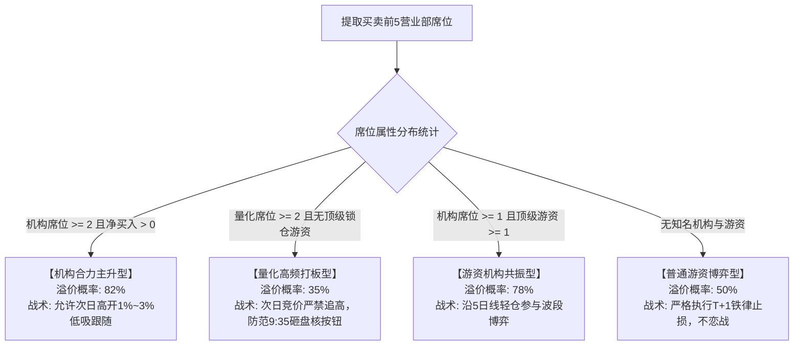
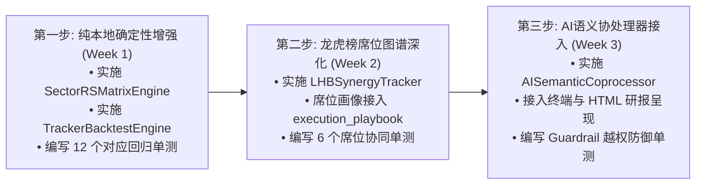

# AST-Trader 未实施核心优化点工程规格说明书与预研成果
# (Future Optimization Specifications & Spikes)

> **文档性质**：本文档为 AST-Trader（A股买方穿透审计与微观主力博弈量化投研系统）尚未实施的具体优化点系统规格书与预研固化成果，为后续工程实施、代码重构及第三方 AI 架构审计提供权威技术依据。
> **基线代码状态**：Git Commit `d19fbde`（74 项单元与集成测试 100% 绿色通过，P0~P2 架构债务全面闭环）。
>
> ⚠️ **基线数字已过时（文档追踪滞后）**：当前实测为 **387 项**（376 离线 + 11 `seednet`）。
> 另注：本文档 §2 的「优化点一 AI 语义协处理器」与 §6.2 三步走计划中的 P3，
> **代码侧已提前落地** —— `core/ai_coprocessor/` 已实装 provider / cache / guard /
> context 与 5 份 prompt，并在 `cli` / `judgment_chain` / `audit_engine` /
> `execution_playbook` 完成 5/5 接线；仅 `config.AI_ENABLED` 默认 `False` 处于休眠。
> 详见 `docs/UNIMPLEMENTED_WORKLIST.md` 的 A-1。

---

## 目录
1. [总体演进图景与边界铁律](#1-总体演进图景与边界铁律)
2. [优化点一：本地轻量 AI 语义协处理器 (AISemanticCoprocessor)](#2-优化点一本地轻量-ai-语义协处理器-aisemanticcoprocessor)
3. [优化点二：行业板块相对强弱轮动矩阵 (SectorRSMatrixEngine)](#3-优化点二行业板块相对强弱轮动矩阵-sectorrsmatrixengine)
4. [优化点三：龙虎榜席位协同与游资胜率跟踪 (LHBSynergyTracker)](#4-优化点三龙虎榜席位协同与游资胜率跟踪-lhbsynergytracker)
5. [优化点四：实盘账本多日量化回测与收益归因引擎 (TrackerBacktestEngine)](#5-优化点四实盘账本多日量化回测与收益归因引擎-trackerbacktestengine)
6. [工程实施路径、目录变更与第三方审计验收标准](#6-工程实施路径目录变更与第三方审计验收标准)

---

## 1. 总体演进图景与边界铁律

### 1.1 演进架构全景

```mermaid
flowchart TD
    subgraph 引擎一_确定性量化底座 [Engine 1: Quantitative Core (Non-Negotiable)]
        M1[通达信行情/L2/三表/F10 eltdx] --> Q1[11项会计审计排雷 AuditEngine]
        M1 --> Q2[反向DCF/SOTP估值双锚 Derivation]
        M1 --> Q3[主力7阶段生命周期状态机 MainForceEngine]
        M1 --> Q4[L2聪明钱Q因子与防伪 Microstructure]
        M1 --> Q5[全市场天梯与投机情绪闸门 MacroRegime]
        Q1 & Q2 & Q3 & Q4 & Q5 --> CORE_CARD[五支柱标准决断卡 Decision Card]
    end

    subgraph 增强模块一_板块与席位协同 [Enhancement: RS & Synergy (Deterministic)]
        S1[全板块行情与资金流] --> SEC_RS[行业板块轮动矩阵 SectorRSMatrix]
        S2[龙虎榜营业部席位] --> LHB_SYN[席位协同作战图谱 LHBSynergyTracker]
        SEC_RS -->|仓位折价乘数 0.0~1.0| CORE_CARD
        LHB_SYN -->|席位协同模式与防砸预警| CORE_CARD
    end

    subgraph 增强模块二_AI语义协处理器 [Enhancement: Semantic Coprocessor]
        CORE_CARD -->|只读注入 Prompt| AI_COP[本地/轻量 LLM 协处理器 AISemanticCoprocessor]
        TXT[定期报告附注 / 业务原文 / 减持公告] --> AI_COP
        AI_COP -->|只读富集| ENRICHED_CARD[双模输出决断卡 Enriched Card]
    end

    subgraph 验证闭环_实盘账本回测 [Verification: Tracker Backtest]
        ENRICHED_CARD --> REC[screener_tracker.jsonl 实盘账本]
        REC --> BTEST[多日撮合回测与收益归因 TrackerBacktestEngine]
        BTEST --> STATS[胜率/盈亏比/最大回撤/夏普比率看板]
    end
```

### 1.2 买方架构三大不可逾越铁律 (Guardrail Non-Negotiables)
1. **绝对禁止 AI 算账与修改数值**：
   * 财务指标、市值得出、DCF 估值区间、主力阶段置信度、板块 RS 分数、连板晋级率，**必须 100% 由本地 Python 确定性代码计算**，严禁大模型参与任何算术推导或覆盖修改；
2. **绝对禁止 AI 篡改决策档位与仓位上限**：
   * 决策档位（`decision_gear`）、建议仓位上限（`position_cap`）与 T+1 唯一失效退出线（`invalidation_line`），只能由量化中台与 `LintValidator` 最终裁定，AI 仅负责定性语言提炼，越权篡改时系统必须强制抛出异常；
3. **数据流严格单向传递**：
   * 只能“量化底座 $\rightarrow$ 语义协处理器”，严禁将 AI 的定性猜测反向注入量化指标计算公式，坚决阻断逻辑污染闭环。

---

## 2. 优化点一：本地轻量 AI 语义协处理器 (AISemanticCoprocessor)

### 2.1 业务痛点与定位
当前 AST-Trader 终端及 HTML 研报已具备毫秒级确定性推导能力，但报告中的核心定性结论采用固化的 Python 字符串模板拼接（如：`f"PE(TTM) {pe:.1f}x 对应隐含增速..."`），语言风格偏向于“参数陈列”，缺乏买方基金经理主笔的犀利盘感与核心矛盾提炼。此外，财报附注长文本（诉讼、关联担保、减值计提）无法被纯表格解析完全覆盖。

### 2.2 接口规范与数据契约

```python
from dataclasses import dataclass
from typing import Any

@dataclass
class AISemanticEnrichment:
    ai_executive_summary: str      # 3~5句精辟买方导读，直击核心矛盾
    ai_footnote_findings: str      # 财报附注/减持/诉讼语义审计挖掘
    ai_devil_advocate: list[str]   # 2个最尖锐的空头证伪反例 (红蓝对抗)

class AISemanticCoprocessor:
    """本地轻量大模型语义协处理器 (支持 Ollama / DeepSeek API / 离线启发式规则)."""

    def __init__(
        self,
        provider: str = "ollama",           # "ollama" | "deepseek" | "fallback_rule"
        model_name: str = "deepseek-r1:8b", # 本地轻量开源模型
        api_base: str = "http://localhost:11434",
        api_key: str | None = None,
        # ★ 不写死数值：统一取超时总纲 config.TIMEOUT_AI（当前 60s，AI 分析接口）
        timeout_seconds: float = config.TIMEOUT_AI,
    ) -> None: ...

    def enrich(self, card: dict[str, Any], raw_texts: dict[str, str]) -> dict[str, Any]:
        """对已算好的标准决断卡进行语义富集并执行 Guardrail 防篡改校验."""
        ...
```

### 2.3 只读 Prompt 模板与严格 JSON Schema
向大模型发送的 Context Prompt 必须严格物理隔离数值计算权限：
```text
【系统角色与不可逾越红线】
你是一名拥有10年A股买方对冲基金经验的高级合规与行业研究员。
以下由本地量化引擎严密计算并锁定的硬指标（你绝对无权改动任何数值与档位）：
- 标的: {name} ({ticker})
- 质地评定: {quality_verdict} (5期ROE趋势: {roe_trend})
- 估值双锚: {odds_verdict} (叙事溢价比例: {narrative_ratio})
- 主力阶段: {main_force_stage} (置信度: {stage_confidence}分)
- 买方决断档位: {decision_gear} (仓位上限: {position_cap}%)
- 致命排雷红旗: {fatal_flags_count} 项

公司最新披露文本底稿:
- 公告摘要: {announcement_summary}
- 财报附注原文: {footnote_text}

【输出约束】
请直接输出标准 JSON，严格包含以下 3 个字段，不得包含额外 Markdown 包装字符：
{
  "ai_executive_summary": "3-5句极具买方洞察力的导读，定性说明当前为什么是/不是好下注",
  "ai_footnote_findings": "针对业务附注中非标、在途减持、存货跌价准备的深扒证据",
  "ai_devil_advocate": ["证伪条件1: ...", "证伪条件2: ..."]
}
```

### 2.4 Guardrail 硬核防篡改门控
在 `enrich()` 返回前，执行严格的运行时断言：
```python
# Guardrail 防篡改校验 (物理锁死关键决策点)
assert enriched_card["position_cap"] == locked_position_cap, "Guardrail 致命警报: position_cap 被大模型篡改!"
assert enriched_card["decision_gear"] == locked_decision_gear, "Guardrail 致命警报: decision_gear 被大模型篡改!"
assert enriched_card["odds_verdict"] == locked_odds_verdict, "Guardrail 致命警报: odds_verdict 被大模型篡改!"
assert enriched_card["quality_verdict"] == locked_quality_verdict, "Guardrail 致命警报: quality_verdict 被大模型篡改!"
```

### 2.5 离线启发式双轨降级实现
当用户未启动本地 Ollama 守护进程、或无网络连接、或模型调用超时（超过 `config.TIMEOUT_AI`，当前 60 秒）时，协处理器**无缝自动降级至离线买方专家规则库**（已在 `scratch/spike_ai_coprocessor.py` 中完整验证通过），保证出报耗时仍控制在 1 秒以内，且 0 报错。

---

## 3. 优化点二：行业板块相对强弱轮动矩阵 (SectorRSMatrixEngine)

### 3.1 业务痛点与定位
A 股短线与波段博弈中存在强烈的“板块协同效应”——“牛市买龙一，弱市抱主线”。若个股自身形态和盘口评分极高，但所属行业板块正处于资金持续净流出、破位跌停蔓延的“分化退潮期”，个股往往面临极高的补跌风险。当前系统缺乏宏观行业与中观板块的相对强弱评分体系。

### 3.2 数学模型设计 (Sector Relative Strength Score)

板块相对强弱得分 $RS \in [0, 100]$，由三大核心维度加权构成：

$$RS = S_{\text{momentum}} + S_{\text{capital}} + S_{\text{breadth}}$$

1. **动量强度分 $S_{\text{momentum}} \in [0, 40]$**：
   $$S_{\text{momentum}} = \text{clip}(PctChg_{5d} \times 2.0, 0, 20) + \text{clip}(PctChg_{\text{today}} \times 3.5, 0, 20)$$
2. **资金合力与吸金度 $S_{\text{capital}} \in [0, 30]$**：
   $$S_{\text{flow}} = \text{clip}\left(\frac{\text{NetFlow}_{\text{wan}}}{50000} \times 10, 0, 20\right), \quad S_{\text{share}} = \text{clip}(\text{TurnoverShare}_{\%} \times 1.5, 0, 10)$$
   $$S_{\text{capital}} = S_{\text{flow}} + S_{\text{share}}$$
3. **梯队赚钱效应与广度 $S_{\text{breadth}} \in [0, 30]$**：
   $$S_{\text{ladder}} = \min(\text{HighestBoard} \times 5.0, 15.0), \quad S_{\text{effect}} = \frac{\text{StocksUpRatio}}{100} \times 15.0$$
   $$S_{\text{breadth}} = S_{\text{ladder}} + S_{\text{effect}}$$

### 3.3 四阶段生命周期与个股仓位折价传导矩阵

| 阶段代码 | 判定标准 | 阶段特征 | 传导至个股的仓位乘数 | 买方风控指令 |
| :--- | :--- | :--- | :---: | :--- |
| **STAGE_MAIN_MARKUP**<br>(主升吸金期) | $RS \ge 75$ 且<br>炸板率 $<25\%$ 且<br>主力净流入 $>0$ | 资金高度认同，领涨板块，龙头连板身位清晰 | **$1.0$** | **允许进攻档位**，允许主升仓或重仓接力 |
| **STAGE_OVERHEATED**<br>(加速过热期) | $RS \ge 70$ 但<br>炸板率 $\ge 35\%$ 或<br>成交占比 $>12\%$ | 情绪极度亢奋但筹码严重拥挤，大单开始对倒派发 | **$0.7$** | **强制折价防守**，个股仓位上限收敛至 70% |
| **STAGE_ACCUMULATION**<br>(底部蓄势/弱分歧) | $40 \le RS < 70$ | 板块温和轮动，多空平衡，尚未形成大合力 | **$0.8$** | **仅限低吸试错**，严禁激进追高追板 |
| **STAGE_RETREAT**<br>(分化退潮期) | $RS < 40$ 或<br>主力净流出 $>3$ 亿或<br>上涨比例 $<30\%$ | 资金大幅抽血出逃，高位龙头断板核按钮 | **$0.0$** | **一票否决禁止买入**，已持股者触发减仓 |

### 3.4 与现有系统集成点
* **数据采集层**：在 `data/eltdx_collector.py` 扩充 `get_sector_bars()` 与 `get_sector_money_flow()`；
* **筛选漏斗层**：在 `screener/rank_composite.py` 中引入 `SectorRSMatrixEngine`，对候选股评分增加板块加权分，若板块处于退潮期则扣除 10 分；
* **决断中枢层**：在 `core/judgment_chain.py` 的 `_decide_gear` 中，`final_pos_cap = base_pos_cap * sector_rs_multiplier`。

---

## 4. 优化点三：龙虎榜席位协同与游资胜率跟踪 (LHBSynergyTracker)

### 4.1 业务痛点与定位
A 股上榜龙虎榜的标的常常表现出极大的次日分化：有些龙虎榜出来次日开盘一字涨停，有些次日直接开盘被核按钮跌停。其核心矛盾在于**席位背后的资金属性**——是真金白银锁仓中军的机构与顶级大游资，还是专门“利用散户信仰在次日开盘抢跑打劫”的量化高频打板席位。

### 4.2 席位画像知识库建模

系统内置标准化买方席位知识库（可配置扩展）：

```python
KNOWN_SEAT_PERSONAS = {
    # 顶级一线锁仓游资
    "中信证券股份有限公司西安朱雀大街证券营业部": {"persona": "方新侠", "style": "主升锁仓/波段加仓", "tag": "TOP_YOUZI"},
    "中国银河证券股份有限公司北京金融街证券营业部": {"persona": "赵老哥", "style": "二板定龙/趋势打板", "tag": "TOP_YOUZI"},
    "国泰君安证券股份有限公司上海江苏路证券营业部": {"persona": "章盟主", "style": "大容量中军/大单托盘", "tag": "TOP_YOUZI"},
    # 量化高频打板席位 (次日砸盘高危)
    "中国国际金融股份有限公司上海分公司": {"persona": "量化主力/外资高频", "style": "算法拆单/次日抢跑", "tag": "QUANT_DUMP"},
    "华泰证券股份有限公司总部": {"persona": "量化打板/融券对冲", "style": "高频打板/次日无溢价开砸", "tag": "QUANT_DUMP"},
    # 机构资金
    "机构专用": {"persona": "公募/社保/险资/私募", "style": "基本面价值/多日锁仓", "tag": "INSTITUTION"},
}
```

### 4.3 席位协同作战模式识别算法



### 4.4 次日开盘竞价挂单战术联动
席位协同评估结果直接输出至 `core/execution_playbook.py`，指导实盘集合竞价操作：
* 命中 `QUANT_DUMP`（量化砸盘型）：挂单价格区间锁定为“低于现价 1.5%~2.5%”或直接撤单观察，禁止 9:25 抢筹；
* 命中 `INSTITUTION`（机构合力型）：挂单价格区间为“现价平盘至 +1.5%”，支持集合竞价成交。

---

## 5. 优化点四：实盘账本多日量化回测与收益归因引擎 (TrackerBacktestEngine)

### 5.1 业务痛点与定位
系统此前在 `screener/tracker.py` 中实现了对每天筛选结果的持久化记录（`config.CACHE_DIR / "screener_tracker.jsonl"`），但**尚未构建自动化收益统计与策略回测闭环**。买方机构无法量化回答：“按照 AST-Trader 推荐池执行，近 30 个交易日的真实胜率是多少？盈亏比是多少？最大回撤是多少？”

### 5.2 回测执行契约与仿真撮合规则

```python
@dataclass
class BacktestSummary:
    total_trades: int           # 总交易样本笔数
    win_trades: int             # 盈利笔数
    loss_trades: int            # 亏损笔数
    win_rate_pct: float         # 胜率 (%)
    avg_return_pct: float       # 单笔平均收益率 (%)
    profit_loss_ratio: float    # 盈亏比 (平均盈利 / 平均亏损)
    max_drawdown_pct: float     # 策略最大回撤 (%)
    sharpe_ratio: float         # 年化夏普比率 (无风险利率 2.0%)
    cumulative_return_pct: float# 累计复利净收益 (%)
```

#### 撮合模拟纪律：
1. **进场撮合**：次日 9:25 集合竞价开盘买入。若开盘价超出设定挂单区间（如大幅高开 $>5\%$），判定为废单不计入持仓；
2. **止损铁律强平**：若次日盘中最低价触碰或跌破决断卡中预设的 `invalidation_rule`（铁律止损价），**必须强制按止损价计入亏损平仓**，绝不进行“未触及平盘继续持有”的乐观假设；
3. **离场撮合**：T+1 交易日尾盘 14:55 收盘价平仓（短线模式）或按 5 日均线破位平仓（波段模式）；
4. **交易摩擦损耗**：单笔交易强制计提 **万分之十五（0.15%）** 的双边印花税、过户费及佣金滑点成本。

### 5.3 命令行扩展接口设计
支持通过 `cli.py` 一键启动实盘回测看板：
```bash
# 默认回测最近 30 天实盘账本
python cli.py backtest

# 指定回测窗口为 90 天，并导出 CSV 交易明细
python cli.py backtest --days 90 --export-csv ./reports/backtest_2026.csv
```

---

## 6. 工程实施路径、目录变更与第三方审计验收标准

### 6.1 模块归属与文件划分规范

| 模块名称 | 所在路径 | 依赖层级 | 外部依赖 |
| :--- | :--- | :---: | :--- |
| **AI 语义协处理器** | `core/ai_coprocessor.py` | 核心中台增强 | `requests` / `urllib` (可选接入本地 Ollama 或 DeepSeek API) |
| **板块 RS 轮动矩阵** | `core/sector_rs.py` | 核心中台特征 | 无外部重度依赖，仅依赖 `pandas` 与 `eltdx` |
| **龙虎榜协同图谱** | `core/lhb_synergy.py` | 核心中台特征 | 依赖 `data/supplement_api.py` |
| **实盘账本回测器** | `screener/backtester.py` | 筛选与复盘层 | 依赖 `screener/tracker.py` |

### 6.2 实施三步走计划 (Phased Implementation Plan)



### 6.3 第三方 AI 审计验收标准 (Audit Checklist)

为便于第三方 AI 或合规专家对后续代码提交进行严谨代码审计，制定以下 **Checklist 验收指标**：

| 审计维度 | 核心核查点 | 合格判定标准 |
| :--- | :--- | :--- |
| **数据纪律 (Data Discipline)** | 是否存在任何捏造默认值？ | 严禁捏造财务数据或仓位；缺失时必须显式标注 `未核验` |
| **架构分层 (Layering)** | 是否新引入任何循环依赖或反向依赖？ | `lint/` 保持纯叶子层；`data/` 严禁反向引入 `core/`；协处理器严禁反向影响底座 |
| **Guardrail 安全性** | 大模型能否篡改仓位上限或行动档位？ | 必须具备显式 `assert` 门禁，篡改时必须立即熔断 |
| **单点真理 (Single Truth)** | 估值与主力行为是否仅在专属支柱中回答？ | 保持 5 支柱单点真理，机检门控覆盖率 100% |
| **可测试性 (Testability)** | 新增模块单测是否包含假绿或同义反复？ | 单测必须使用具体固定断言，杜绝 `if ... else ...` 形式的伪用例 |
| **性能指标 (Performance)** | 离线单股全流程分析耗时是否增加？ | 离线降级状态下耗时必须 $\le 2.0$ 秒；全市场漏斗 $\le 15$ 秒 |
